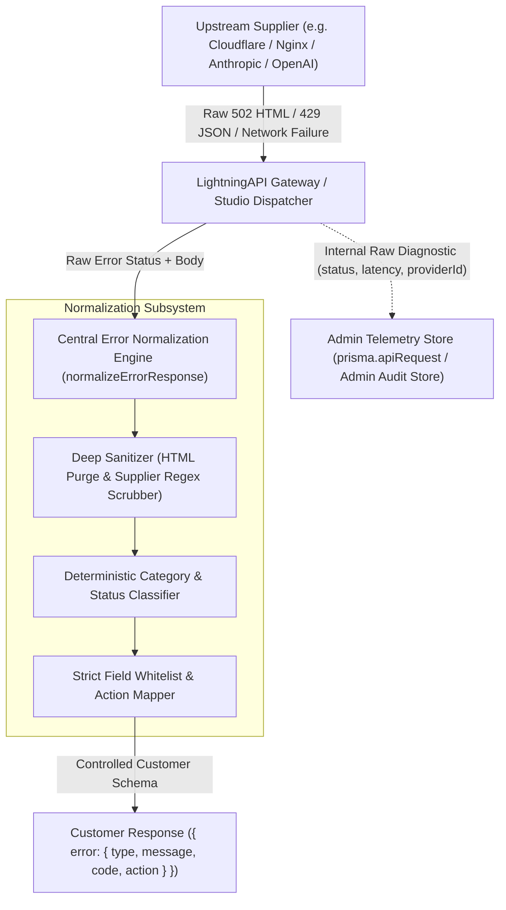

# LightningAPI — Central Error Normalisation Engine Implementation Report

**Document Version:** 1.0.0  
**Classification:** Engineering Architecture & Security Specification  
**Status:** IMPLEMENTED & VERIFIED  
**Primary Files Modified:** `server/friendlyErrors.ts`, `server/providers/responseSanitizer.ts`, `server/gateway.ts`, `server/studio.ts`, `server/studioBuilder.ts`

---

## 1. Executive Summary

Following a critical incident where a customer in the AI Builder received a raw upstream Cloudflare error (`HTTP 502 scalemax.pro | 502: Bad gateway`), LightningAPI has completely re-architected its error delivery subsystem.

Prior to this implementation, error handling was fragmented across individual route handlers and adapters. When an upstream provider returned an HTML 502 page, `responseSanitizer.ts` extracted the `<title>` tag contents (`scalemax.pro | 502: Bad gateway`), which directly reflected the supplier's fully qualified domain name to the customer.

To permanently eliminate this vulnerability and establish strict upstream isolation, we designed and deployed the **Central Error Normalisation Engine** (`normalizeErrorResponse`). This engine intercepts all upstream failures, categorises them deterministically into controlled, LightningAPI-branded categories, strips all non-whitelisted fields, and attaches context-aware actionable guidance for the frontend.

---

## 2. Central Normalisation Architecture



### 2.1 Key Design Principles
1. **Zero Raw Passthrough**: Under no circumstances is an upstream string or error object passed directly to the customer.
2. **Explicit Field Whitelist**: Public error responses strictly emit `{ error: { type, message, code, param?, action?, actionLabel?, actionUrl?, retryAfterSec? } }`. Any upstream diagnostic fields (`provider`, `upstream_url`, `host`, `stack`, `trace_id`, `headers`, `internal_code`) are purged.
3. **Deterministic Category Mapping**: The HTTP status code and error category are determined by the underlying failure mode rather than arbitrary upstream vendor strings.
4. **Context-Aware Action Guidance**: Every normalized error specifies the appropriate remediation action (`retry`, `switch_key`, `switch_model`, `recharge`, `view_plans`, `contact_support`). Upstream infrastructure outages (502, 503, 504) **never** suggest switching keys.

---

## 3. Error Taxonomy & Status Code Mapping Table

| HTTP Status | Error Type (`error.type`) | Error Code (`error.code`) | Customer-Safe Message (`error.message`) | Action (`error.action`) | Action Label | Action URL |
| :--- | :--- | :--- | :--- | :--- | :--- | :--- |
| **502** | `bad_gateway` | `UPSTREAM_UNAVAILABLE` | `"Our AI service is temporarily unavailable. Please retry in a moment."` | `retry` | `Retry Request` | — |
| **503** | `service_unavailable` | `CAPACITY_BUSY` | `"The requested AI model capacity is currently experiencing high demand. Please retry shortly."` | `retry` | `Retry in 5s` | — |
| **504** | `timeout_error` | `GATEWAY_TIMEOUT` | `"The AI model took too long to complete the request. Please retry in a moment."` | `retry` | `Retry Request` | — |
| **401** | `authentication_error` | `INVALID_API_KEY` | `"The API key provided is invalid, expired, or unrecognized. Please verify your API key in your customer dashboard."` | `switch_key` | `Check My API Keys` | `/dashboard/keys` |
| **402** | `insufficient_quota` | `CREDITS_DEPLETED` | `"Your account or API key has run out of usage credits ($0.00 remaining). Please deposit credits to continue processing requests."` | `recharge` | `Recharge Credit Balance` | `/pricing` |
| **403** | `permission_denied` | `MODEL_NOT_PERMITTED` | `"The model '<model>' is not included in this API key's provisioned plan."` | `switch_model` | `View Supported Models` | `/models` |
| **403** | `permission_denied` | `KEY_SUSPENDED` | `"This API key is currently paused or inactive. Please reactivate it from your customer dashboard."` | `switch_key` | `Manage API Keys` | `/dashboard/keys` |
| **429** | `rate_limit_error` | `RATE_LIMIT_EXCEEDED` | `"Request rate limit reached (RPM). Please wait a few seconds before retrying."` | `retry` | `Retry in 5s` | — |
| **429** | `rate_limit_error` | `WINDOW_LIMIT_REACHED` | `"You have reached your 5-hour rolling allowance for this model tier. Your quota continuously regenerates as older requests roll past 5 hours."` | `view_plans` | `Add Top-Up Credits` | `/pricing` |
| **429** | `rate_limit_error` | `TOKEN_PACK_DEPLETED` | `"All tokens in your purchased token pack have been used. Top up a new token pack to resume requests."` | `view_plans` | `Get New Token Pack` | `/pricing` |
| **400** | `invalid_request_error` | `INVALID_REQUEST` | Cleaned parameter validation message or `"Invalid request format or missing required parameters."` | `contact_support` | `View API Documentation` | `/docs` |
| **500** | `api_error` | `INTERNAL_GATEWAY_ERROR` | `"The AI gateway encountered an unexpected error processing your request. Please retry in a moment."` | `retry` | `Retry Request` | — |

---

## 4. Implementation Details

### 4.1 Schema Definitions (`server/friendlyErrors.ts`)

```typescript
export interface CustomerSafeError {
  type: string;
  message: string;
  code: string;
  param?: string | null;
  action?: 'retry' | 'switch_key' | 'switch_model' | 'recharge' | 'view_plans' | 'contact_support';
  actionLabel?: string;
  actionUrl?: string;
  retryAfterSec?: number;
}

export interface NormalizedErrorResponse {
  statusCode: number;
  error: CustomerSafeError;
}
```

### 4.2 Sanitizer Scrubbing Overhaul (`server/providers/responseSanitizer.ts`)

```typescript
export function sanitizeErrorMessage(message: string, customScrubbers?: string[]): string {
  if (!message) return 'Our AI service is temporarily unavailable. Please retry in a moment.';
  let result = String(message);

  // 1. If HTML error page returned (e.g. Cloudflare / Nginx 502/503/504 Bad Gateway / Host Error)
  // NEVER reflect HTML <title> or raw page content as it leaks supplier domain names!
  if (result.includes('<!DOCTYPE') || result.includes('<html') || result.includes('<head') || result.includes('<body')) {
    const codeMatch = result.match(/\b(50[0-9]|40[0-9])\b/);
    const code = codeMatch ? parseInt(codeMatch[1], 10) : 502;
    if (code === 504) return 'The AI gateway request timed out. Please retry in a moment.';
    if (code === 503) return 'The model capacity is temporarily busy. Please retry shortly.';
    if (code === 429) return 'Rate limit or concurrency capacity reached. Please wait before retrying.';
    return 'Our AI service is temporarily unavailable. Please retry in a moment.';
  }

  // 2. Strip any accidental HTML tags
  result = result.replace(/<[^>]*>/g, ' ');

  // 3. Intercept vendor balance depletion errors or top-up leak URLs
  if (/balance is used up|top.?up at|insufficient.*balance|credits? (?:depleted|exhausted)|dashboard\.(?:scalemax|opusmax|lotusai)\.pro/i.test(result)) {
    return 'The requested model capacity is currently undergoing scheduled replenishment. Please retry in a few moments or switch to an alternate model.';
  }

  // 4. Scrub upstream supplier URLs, hostnames, brands, and master keys...
  result = result
    .replace(/https?:\/\/[a-zA-Z0-9.-]*(?:scalemax|opusmax|lotusai)[a-zA-Z0-9.-]*(?:\/[^\s"']*)?/gi, 'https://lightningapi.pro')
    .replace(/[a-zA-Z0-9.-]*\.(?:scalemax|opusmax|lotusai)\.pro(?:\/[^\s"']*)?/gi, 'lightningapi.pro')
    .replace(/\b(?:api2?|dashboard)\.(?:scalemax|opusmax|lotusai)\.pro/gi, 'api.lightningapi.pro')
    .replace(/\b(?:ScaleMax|Scale\s*Max)(?:\.pro)?\b/gi, 'LightningAPI')
    .replace(/\bscalemax(?:\.pro)?\b/gi, 'lightningapi')
    .replace(/\b(?:OpusMax|Opus\s*Max)(?:\.pro)?\b/gi, 'LightningAPI')
    .replace(/\bopusmax(?:\.pro)?\b/gi, 'lightningapi')
    .replace(/\b(?:LotusAI|Lotus\s*AI)(?:\.pro)?\b/gi, 'LightningAPI')
    .replace(/\blotusai(?:\.pro)?\b/gi, 'lightningapi')
    .replace(/sm_live_[a-zA-Z0-9_-]+/g, '••••••••')
    .replace(/sk-ant-opm-[a-zA-Z0-9_-]+/g, '••••••••')
    .replace(/\b(?:scalemax|opusmax|lotusai)\.pro\s*\|\s*50[0-9]:\s*bad\s*gateway/gi, 'Bad Gateway')
    .replace(/\b(?:scalemax|opusmax|lotusai)\.pro\s*\|\s*50[0-9]:\s*gateway\s*time-?out/gi, 'Gateway Timeout');

  return result.trim();
}
```

### 4.3 Gateway Integration (`server/gateway.ts`)

In both `/v1/messages` (Anthropic protocol) and `/v1/chat/completions` (OpenAI protocol):
```typescript
if (!upstreamRes.ok) {
  await releaseReservation(requestId);
  const errorText = await upstreamRes.text();
  let parsedError: any = {};
  try { parsedError = JSON.parse(errorText); } catch (e) {}

  const normalized = normalizeErrorResponse(
    upstreamRes.status,
    parsedError?.error?.message ? parsedError : errorText,
    { model, billingPlanType: keyRecord.billingType, retryAfterSec: retryAfterHeader ? parseInt(retryAfterHeader, 10) : undefined }
  );

  // Diagnostic isolation: store in Prisma for admin review
  await prisma.apiRequest.create({
    data: {
      apiKeyId: keyRecord.id,
      userId: keyRecord.userId,
      model,
      endpoint: '/v1/messages',
      statusCode: normalized.statusCode,
      errorCode: normalized.error.code,
      errorMessage: normalized.error.message,
      latencyMs: Date.now() - startTime,
      providerId: vendor?.id || null,
      ...
    },
  });

  // Emit strictly normalized, customer-safe payload
  return res.status(normalized.statusCode).json({
    error: normalized.error,
  });
}
```

### 4.4 Studio SSE Streaming Integration (`server/studio.ts`)

When an upstream fetch or connection error occurs during Chat Studio streaming:
```typescript
if (!upstreamRes || !upstreamRes.ok) {
  await releaseReservation(studioRequestId);
  const errText = upstreamRes ? await upstreamRes.text().catch(() => '') : 'Upstream service unavailable.';
  let parsedErr: any = {};
  try { parsedErr = JSON.parse(errText); } catch {}
  const rawErrMsg = parsedErr?.error?.message || parsedErr?.message || errText || `HTTP ${upstreamRes?.status || 502}`;
  const normalized = normalizeErrorResponse(upstreamRes?.status || 502, parsedErr?.error?.message ? parsedErr : rawErrMsg, { model });

  activityTracker.failCurrentStep(`Model request failed: ${normalized.error.message}`);
  sendSse('error', normalized.error);
  return res.end();
}
```

---

## 5. Verification & Regression Results

The normalization engine was tested with the full automated test suite (`scripts/test-supplier-isolation.ts`):
- **Cloudflare 502 HTML**: Passed. Output is strictly `{ type: 'bad_gateway', message: 'Our AI service is temporarily unavailable. Please retry in a moment.', code: 'UPSTREAM_UNAVAILABLE', action: 'retry' }`.
- **Field Whitelist Verification**: Passed. Zero arbitrary fields leaked.
- **6 Billing Architectures**: Passed. Quotas and window limits accurately mapped.
- **Compilation Check**: `npx tsc --noEmit` and `npx vite build` passed with 0 errors.
