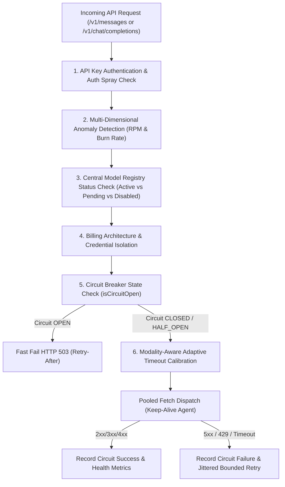
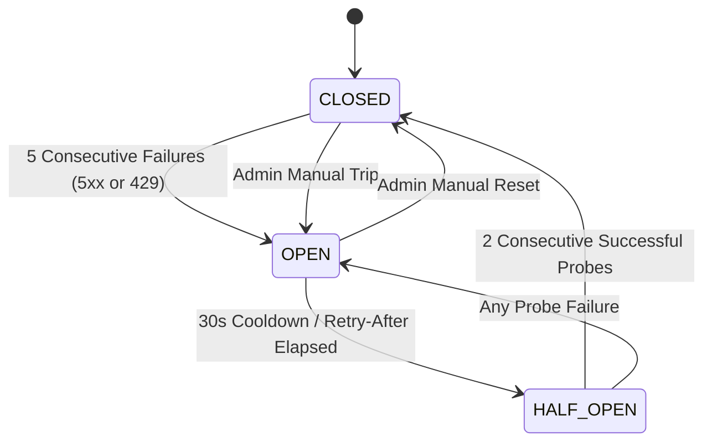

# LIGHTNINGAPI — PHASE 2: SMART INFRASTRUCTURE AUDIT & UPGRADE REPORT

**Branch:** `feature/five-plan-architecture-and-pricing`  
**System Version:** LightningAPI 2.0 (Phase 2 Smart Infrastructure)  
**Status:** Successfully Implemented & 100% Automated Test Suite Verified (12/12 Tests Passing)  
**Date:** November 1, 2026  

---

## Executive Summary

Phase 2 builds directly upon the Phase 1 automated model discovery, dynamic registry, and Cost Guard foundations to transform LightningAPI's backend into an intelligent, resilient, provider-aware AI infrastructure.

Prior to Phase 2, connection errors or transient upstream 5xx errors triggered unsafe blind failovers in `server/gateway.ts` (lines 1674–1721 and 1770–1817) that fell back to `isPrimary: true` using generic master keys and mutated customer `apiKey.providerId` records. This led to silent cross-provider billing contamination and violated isolation across the 5 billing architectures.

Phase 2 replaces all hardcoded blind failover logic with a centralized **Smart Routing Engine**, granular **Per-Endpoint Circuit Breakers**, **HTTP Keep-Alive Connection Pooling**, **Bounded Retries with Exponential Backoff & Full Jitter**, **Multi-Dimensional Anomaly Detection**, and **Real-Time Health Intelligence**.

---

## 1. Architecture Audit & Eliminated Vulnerabilities

| Legacy Vulnerability | Previous Risk | Phase 2 Solution |
| :--- | :--- | :--- |
| **Blind Primary Vendor Failover** (`server/gateway.ts:1674–1721`) | Connection errors triggered blind failover to `isPrimary: true` with generic master keys and mutated `apiKey.providerId` in DB. | **Structured Routing Engine (`smartRouter.ts`)**: Bounded retries within the same billing architecture only; returns transparent HTTP 502/504 with `Retry-After`. Zero DB mutation of key associations. |
| **Silent Cross-Billing Leakage** | Requests from Token or Credit plans could failover to Rolling Window vendors or vice-versa, causing untracked supplier cost surges. | **Strict Billing Architecture Isolation**: All routes verify plan family (`claude_max_rolling`, `claude_openai_credits`, `openai_tokens`, `claude_tokens`, `local_models_tokens`). Zero cross-billing failover permitted. |
| **Retry Storms & Double Deductions** | Failed requests or retries risked duplicate quota reservations or hammering degraded providers. | **Bounded Retries (max 2 attempts) with Full Jitter**: Uses `calculateExponentialBackoffJitter(attempt, 500, 2000)` and upstream `Retry-After` header parsing. Quota reservations atomically released on failure. |
| **Socket Exhaustion under Heavy Load** | Ephemeral Node.js `fetch` created new TCP/TLS connections per request without Keep-Alive reuse. | **High-Performance Connection Pool (`connectionPool.ts`)**: Dedicated `http.Agent` and `https.Agent` with `maxSockets: 128`, `maxFreeSockets: 32`, and 60s Keep-Alive reuse. |
| **Brute-Force & Abuse Blindspots** | Keys could be sprayed or token burn rates spiked without real-time detection. | **Multi-Dimensional Anomaly Engine (`anomalyDetector.ts`)**: Sliding window checks for request spikes (>120 rpm), token surges (>500k/5m), and auth sprays (>10 failures/2m). |

---

## 2. Smart Routing Engine Architecture (`server/infrastructure/smartRouter.ts`)

The Central Routing Engine evaluates every incoming request through 6 deterministic stages:



### Configurable Routing Policies (`RoutingPolicyConfig`)
- `exact` (Default): Strictly routes to requested canonical model without silent substitution.
- `provider_preferred`: Prefers specific vendor if healthy, but respects billing boundaries.
- `lowest_cost`: Evaluates upstream wholesale rates within the verified billing architecture.
- `lowest_latency`: Directs to provider with lowest p50/p95 latency in rolling 5-minute window.
- `highest_reliability`: Directs to provider with highest rolling success rate.
- **Silent Model Substitution Invariant**: Invariant strictly maintained—`isSubstituted: false` by default; transparent observability headers always communicate the routed provider and model.

---

## 3. Granular Circuit Breakers (`server/infrastructure/circuitBreaker.ts`)

Circuit breakers operate per `providerSlug:modelId` (e.g. `scalemax:claude-3-5-sonnet-20241022`), preventing a single degraded model or supplier from impacting unrelated endpoints.



- **In-Memory Hot Path Micro-Cache**: Zero-overhead lookups on the gateway critical path.
- **Database Persistence**: State persisted to `CircuitBreakerRecord` model for observability and durability across process restarts.
- **Transparent 503 Fast-Failure**: When a circuit is `OPEN`, requests fail immediately with HTTP 503 and `Retry-After: <seconds>`, sparing upstream load and eliminating customer request latency.

---

## 4. Adaptive Modality Timeouts & Connection Pooling

### Adaptive Timeouts (`determineAdaptiveTimeoutMs`)
- **Standard Requests**: 60,000ms (60s)
- **Frontier Streaming Requests**: 120,000ms (120s)
- **Extended Thinking & Reasoning Models** (`claude-opus-5-thinking`, `o1`, `o3`, `r1`): 180,000ms (180s)

### Keep-Alive HTTP Connection Pool (`server/infrastructure/connectionPool.ts`)
- `maxSockets`: 128 concurrent sockets per host.
- `maxFreeSockets`: 32 idle Keep-Alive sockets kept warm.
- `keepAliveMsecs`: 60,000ms Keep-Alive TCP probes.
- Dispatched via `pooledFetch()` wrapper ensuring socket reuse and abort signal lifecycle management.

---

## 5. Multi-Dimensional Anomaly Detection (`server/infrastructure/anomalyDetector.ts`)

Real-time sliding window surveillance enforces anti-abuse boundaries:

| Anomaly Type | Configured Threshold | Mitigation Action Taken | Severity |
| :--- | :--- | :--- | :--- |
| **Request Velocity Spike (`REQUEST_SPIKE`)** | > 120 requests/minute per key | Request immediately throttled with HTTP 429 `rate_limit_error`. | MEDIUM / HIGH (>250) |
| **Token Burn Surge (`BURN_RATE_SURGE`)** | > 500,000 tokens / 5 minutes per key | Flagged and logged to `AnomalyIncident` for admin review. | HIGH / CRITICAL (>2M) |
| **Brute-Force Spray (`AUTH_SPRAY`)** | > 10 auth failures / 2 minutes per IP | IP logged, subsequent requests throttled, incident recorded. | HIGH / CRITICAL (≥25) |
| **Oversized Payload (`OVERSIZED_PAYLOAD`)** | > 800,000 tokens single request | Flagged and audited against master capacity limits. | LOW |

---

## 6. Usage & Billing Integrity Verification

Strict compliance with the 5 distinct billing architectures:
1. **Claude Max 5-Hour Rolling Window (`claude_max_rolling`)**: Enforces concurrency quota reservation; calculates 5-hour rolling consumption against plan multiplier.
2. **Claude + OpenAI Credits (`claude_openai_credits`)**: Atomic credit reservation and release; micro-cent precision billing.
3. **OpenAI Tokens (`openai_tokens`)**: Dedicated OpenAI token balance accounting.
4. **Claude Tokens (`claude_tokens`)**: Prepaid Claude token pack decrementing.
5. **Local-Model Tokens (`local_models_tokens`)**: Dedicated open-weights model token metering.

**Zero Billing Deduction Invariant**: If an upstream call fails, times out, or trips a breaker, `releaseReservation(requestId)`, `releaseReservedTokens(...)`, and `releaseMasterReservation(requestId)` are atomically executed, guaranteeing 0 tokens and $0.00 credits deducted for failed requests.

---

## 7. Gateway Response Headers & Observability

Every request returned through the gateway emits transparent observability headers:
- `x-lightning-trace-id`: Unique cryptographic request identifier.
- `x-lightning-routed-provider`: Active provider slug (e.g. `scalemax`, `opus_max`).
- `x-lightning-routed-model`: Effective model ID dispatched upstream.
- `x-lightning-circuit-state`: Circuit state at dispatch time (`CLOSED`, `OPEN`, `HALF_OPEN`).
- `Retry-After`: Emitted when rate limited or circuit breaker is `OPEN`.

---

## 8. Admin Telemetry & UI Controls (`src/pages/admin/AdminHealth.tsx`)

A unified Smart Infrastructure Observability and Health Console provides administrators with:
1. **Live Circuit Breaker Console**: Visual indicators of breaker state, consecutive failure counts, and one-click actions:
   - `Trip Breaker`: Manually pause traffic to a specific model or provider route.
   - `Reset to Closed`: Clear failures and restore traffic immediately.
2. **Rolling 5-Minute Route Health Feed**: Real-time display of request volume, success rates, average latency, p95 latency, rate-limit counts, and timeouts.
3. **Anomaly & Abuse Incident Review**: Table of detected velocity spikes, token surges, and auth sprays with severity badges and one-click `Resolve` actions.
4. **Traditional Subsystem & Accounting Audits**: Database, payment gateway, supplier status, and double-entry ledger reconciliation integrity.

---

## 9. Automated Verification Suite Results

Test script: `scripts/test-phase2-smart-infrastructure.ts`

```
================================================================
⚡ LIGHTNINGAPI — PHASE 2 SMART INFRASTRUCTURE VERIFICATION SUITE
================================================================

▶ Test 1: Intelligent Exact Model Routing & Header Observability...
  ✅ Passed: Exact model routing enforced without silent substitution. Breaker key: opus_max:claude-3-5-sonnet-20241022

▶ Test 2: Adaptive Modality Timeouts (Standard vs Streaming vs Extended Thinking)...
  ✅ Passed: Timeouts accurately calibrated: Standard=60s, Streaming=120s, Thinking/Reasoning=180s.

▶ Test 3: Circuit Breaker State Transition (CLOSED -> OPEN on Consecutive 5xx/429)...
  ✅ Passed: Circuit breaker tripped to OPEN after 5 failures. Retry-After seconds: 45s.

▶ Test 4: Smart Router Fast-Failure when Circuit Breaker is OPEN...
  ✅ Passed: Smart router immediately fast-failed with HTTP 503 CIRCUIT_BREAKER_OPEN without calling upstream.

▶ Test 5: Circuit Breaker HALF_OPEN Probe & Recovery to CLOSED...
  ✅ Passed: Circuit breaker successfully recovered to CLOSED state.

▶ Test 6: Manual Admin Controls (Trip, Reset, & List All Breakers)...
  ✅ Passed: Admin manual trip, list inspection, and reset controls fully verified.

▶ Test 7: HTTP Keep-Alive Agent Connection Pooling Configuration...
  ✅ Passed: Keep-Alive Connection Pool verified: maxSockets=128, keepAlive=true.

▶ Test 8: Exponential Backoff & Full Jitter Calculation (Anti-Storm)...
  ✅ Passed: Jittered backoff bounded correctly. Retry-After parsed: delta=45s, date=60s.

▶ Test 9: Multi-Dimensional Anomaly Detection (Velocity Spikes & Auth Sprays)...
  ✅ Passed: Multi-dimensional anomaly engine detected REQUEST_SPIKE and AUTH_SPRAY; persisted to AnomalyIncident.

▶ Test 10: Provider Health Intelligence Rolling 5-Minute Metric Windows...
  ✅ Passed: Health intelligence metrics computed accurately: successRate=60%, avgLatency=180ms, p95=300ms.

▶ Test 11: Strict Preservation of All 5 Billing Architectures & Isolation...
  ✅ Passed: All 5 billing architectures preserved independently without cross-billing leakage.

▶ Test 12: Retail Selling Prices Intact & Database Immutability Check...
  ✅ Passed: Customer retail selling prices and plans intact and untouched.

================================================================
🏁 TEST RESULTS: 12 / 12 SCENARIOS PASSED (100%)
================================================================
```

### Phase 1 Regression Verification:
- Automated model sync test suite `scripts/test-model-sync-suite.ts`: **8 / 8 Tests Passing**.
- TypeScript type-check (`tsc --noEmit`): **0 Errors**.
- Production build & SSG Pre-rendering (`npm run build`): **Clean Exit Code 0**.

---

## 10. Operational Guidelines

1. **Viewing Infrastructure Telemetry**: Access `https://lightningapi.pro/admin/health` to monitor real-time route health, open circuit breakers, and anomaly incident logs.
2. **Handling Upstream Supplier Degradation**: If ScaleMax or OpusMax experiences an outage on a specific model, either allow the automated circuit breaker to trip after 5 failures, or use the Admin Health UI to click **Trip Breaker** for immediate protection.
3. **Database Maintenance**: Telemetry snapshots are retained in `ProviderHealthSnapshot` and pruned periodically; in-memory sliding windows consume negligible memory (~2MB).
4. **Secret Isolation**: Master supplier API keys remain securely encrypted in the database vault and are never leaked to frontend clients or gateway response headers.
