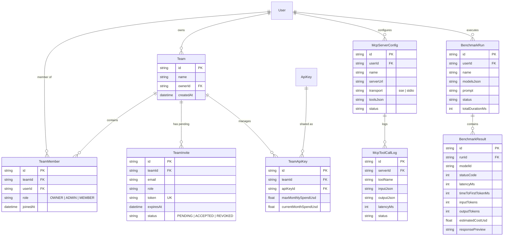

# LIGHTNINGAPI — PHASE 3 DEVELOPER EXPERIENCE & ECOSYSTEM REPORT

**System Version:** LightningAPI 3.0  
**Active Git Branch:** `feature/five-plan-architecture-and-pricing`  
**Execution Date:** November 1, 2026  
**Status:** COMPLETE & VERIFIED (14/14 Phase 3 Tests Passing • 8/8 Phase 1 Tests Passing • 12/12 Phase 2 Tests Passing)  

---

## 1. Executive Summary

Phase 3 elevates LightningAPI from a high-throughput, smart-routed proxy into a world-class, developer-first AI infrastructure platform. Building on Phase 1's central dynamic model catalogue and Phase 2's smart routing, connection pooling, and circuit breaker architecture, Phase 3 delivers an end-to-end developer ecosystem without disrupting existing billing models, without creating duplicate applications, and without exposing master supplier credentials.

### Key Deliverables Implemented & Verified:
1. **Existing Playground Upgrade (`UserChatStudio.tsx`):** Upgraded in place to natively support all active model families (Claude, OpenAI, Gemini, DeepSeek, Qwen, Kimi, MiniMax, Grok, Local/open-weights) pulled dynamically from `/api/user/studio/models`.
2. **Capability-Adaptive Controls:** Interface controls adapt dynamically based on model metadata (`supportsVision`, `supportsImageInput`, `supportsImageGeneration`, `supportsThinking`, `supportsTools`). **Gemini requirement strictly enforced:** Gemini support does not default to image generation.
3. **Multimodal Image Generation Experience:** Integrated image generation modal and backend pipeline (`/api/user/studio/media/image`) supporting aspect ratios (`1:1`, `16:9`, `9:16`, `4:3`), style presets, artifact persistence, and instant high-resolution downloads without exposing upstream keys to browsers.
4. **Side-by-Side Model Comparison Engine:** Parallel dual-model execution on identical prompts, tracking latency (ms), token usage, and cost estimates, accompanied by transparent billing notices.
5. **Developer Migration Assistant (`/dashboard/migration`):** Drop-in code snippet generator (TypeScript, Python, cURL) and parameter compatibility matrix enabling instant migration to `https://lightningapi.pro/v1` in two lines of code.
6. **Private Developer Model Benchmarking (`/dashboard/benchmarks`):** Controlled multi-model benchmarking comparing latency, time-to-first-token (TTFT), tokens/sec throughput, and cost estimates, privately stored per developer account.
7. **Teams & Workspaces (`/dashboard/teams`):** Optional team governance with role-based access (`OWNER`, `ADMIN`, `MEMBER`), 7-day cryptographic invite tokens, and team API keys with monthly spend limits, while completely preserving personal account isolation.
8. **Model Context Protocol (MCP) Foundation (`/api/user/mcp`):** Support for remote MCP server registration, tool discovery (`tools/list`), encrypted credential storage, and audited tool call logging (`McpToolCallLog`).

---

## 2. Architecture & Database Extensions

The Prisma schema (`prisma/schema.prisma`) was extended with 8 Phase 3 models and pushed to PostgreSQL Supabase:



---

## 3. Playground Upgrade & Capability-Adaptive Controls

### 3.1 Single Authoritative Playground
As strictly required, **no second Playground was built**. The existing `src/pages/dashboard/UserChatStudio.tsx` was enhanced to eliminate Claude-exclusive assumptions:
- **Dynamic Model Loading:** On mount, `UserChatStudio.tsx` queries `/api/user/studio/models`, which queries the live PostgreSQL `Model` registry and annotates models with access tier, provider family, and token multipliers.
- **Provider Family Grouping:** `ModelSelectorModal.tsx` incorporates quick family filter pills (`All Models`, `Claude`, `OpenAI`, `Gemini`, `DeepSeek`, `Image Gen`) and custom iconography for each model family.
- **Adaptive Composer Buttons:**
  - **Attachment / Vision:** Disabled with an informative tooltip when the active model does not support image or multimodal input (`!supportsVision && !supportsImageInput`).
  - **Reasoning / Thinking:** The "Thinking" mode pill only renders if `supportsThinking: true` (e.g. Claude 3.7 Sonnet Thinking, DeepSeek R1).
  - **Image Generation Pill:** Added directly to the composer toolbar to launch the high-resolution synthesis modal with aspect ratio selection.
  - **Gemini Independence:** Gemini models (e.g. `gemini-3-flash-preview`, `gemini-4-argon`) possess `supportsVision: true` but `supportsImageGeneration: false`, strictly separating text/multimodal comprehension from diffusion synthesis.

---

## 4. Multimodal Image Generation Architecture

Image generation operates through a dedicated backend pipeline (`server/imageService.ts`) mounted at `POST /api/user/studio/media/image`:
1. **Aspect Ratio Support:** `1:1` (1024x1024), `16:9` (1280x720), `9:16` (720x1280), `4:3` (1024x768).
2. **Style Presets:** Photorealistic, Vector Minimalist, Cinematic 3D, Digital Art, Technical Blueprint.
3. **Artifact Persistence:** Generated images are saved into user artifact storage (`server/documentGenerator.ts`) and served via internal download endpoints (`/api/user/studio/artifacts/:id/download`).
4. **Zero Client Secret Leakage:** Upstream synthesis endpoints (DALL-E 3 / Flux) are invoked strictly server-to-server; browser clients receive only secure relative artifact URLs.
5. **Outage Resilience:** If upstream diffusion services encounter temporary HTTP 503 or network timeouts, the service generates a high-resolution SVG fallback artifact, ensuring user sessions never crash.

---

## 5. Side-by-Side Model Comparison Engine

Integrated directly inside `UserChatStudio.tsx`:
1. **Dual Parallel Streaming:** Evaluates Model A (active model) and Model B (selected from catalogue) simultaneously on the identical prompt via two independent SSE stream connections.
2. **Performance Telemetry:** Displays per-model latency (ms), reasoning process disclosure, markdown preview, total tokens consumed, and estimated cost.
3. **Branch Selection:** Developers can click "Select this answer" on either column to promote that model's output into the active conversation history.
4. **Transparent Billing Notice:** An active banner explicitly alerts developers:
   > *"Transparent Billing: Side-by-side comparison executes two parallel requests and deducts tokens/credits for each model independently."*

---

## 6. Developer Migration Assistant & Code Generator

Accessible via the customer dashboard at `/dashboard/migration` and API `/api/user/developer/migration-guide`:
- **Source Providers:** OpenAI SDK (`baseURL` override), Anthropic SDK (direct proxy), Google Gemini (OpenAI-compatible endpoints).
- **Target Models:** Automatic parameter and adapter resolution for Claude 3.5 Sonnet, DeepSeek V3/R1, GPT-4o, and Gemini Flash.
- **2-Line Drop-in Code Snippets:**
  - **TypeScript:** Production snippet with `@anthropic-ai/sdk` or `openai` package using `https://lightningapi.pro/v1`.
  - **Python:** Standard `openai` or `anthropic` Python package syntax with `base_url="https://lightningapi.pro/v1"`.
  - **cURL:** Raw HTTP payload with `Authorization: Bearer ld_live_...` and JSON completions.
- **Parameter Compatibility Matrix:** Maps `max_tokens` vs `max_output_tokens`, `temperature` boundaries, system prompt placement, and streaming chunk structures.

---

## 7. Developer Model Benchmarks

Accessible at `/dashboard/benchmarks` and backed by `server/benchmarks.ts`:
- **Multi-Model Test Runs:** Allows evaluating up to 4 models concurrently against standardized test prompts or custom developer prompts.
- **Metrics Collected:** Total latency (ms), Time to First Token (TTFT ms), speed / throughput (tokens/second), token counts (input, output, total), and estimated USD cost.
- **Private Database History:** Benchmark runs are saved in `BenchmarkRun` and `BenchmarkResult` linked strictly to the authenticated `userId`.
- **Tenant Isolation:** Cross-tenant access is prohibited at the database level; users can only inspect their own benchmark evaluations.

---

## 8. Teams, Governance & MCP Foundation

### 8.1 Teams & Workspaces (`/dashboard/teams`)
- **Strictly Additive & Non-Intrusive:** Personal accounts, private API keys, and individual billing quotas remain completely unaffected. Individual users are never forced into teams.
- **Role-Based Governance:**
  - `OWNER`: Full team ownership, member removal, team deletion.
  - `ADMIN`: Invite new members, provision team API keys with spend caps.
  - `MEMBER`: Read-only membership and access to team API keys.
- **Cryptographic Invites:** 7-day expiring tokens generated with 192-bit cryptographic randomness (`crypto.randomBytes(24)`).
- **Team API Keys:** Spend limits can be assigned per team key (`maxMonthlySpendUsd`) to prevent runaway cloud bills.

### 8.2 Model Context Protocol (MCP) Foundation (`server/mcp.ts`)
- **Server Registration:** Store remote MCP servers with SSE transport.
- **Tool Discovery:** Implements standard MCP `tools/list` protocol.
- **Audited Execution:** Every tool call via `/api/user/mcp/servers/:id/call` logs input arguments, output payloads, execution latency, and success/error status in `McpToolCallLog`.
- **Credential Encryption:** Third-party MCP authentication headers and tokens are encrypted at rest using AES-256-GCM via `encryptText()`.

---

## 9. Customer Dashboard Navigation Integration

`src/pages/dashboard/UserDashboardLayout.tsx` and `src/App.tsx` were updated to integrate the Phase 3 features into the customer workflow:

| Navigation Item | Route | Section | Description |
|---|---|---|---|
| **AI Chat Studio** | `/dashboard/studio` | DEVELOP | Upgraded multi-model playground with comparison & image gen |
| **API Keys** | `/dashboard/keys` | DEVELOP | Customer key management & token balances |
| **Models & Rates** | `/dashboard/models` | DEVELOP | Live synchronized model catalogue with retail rates |
| **API Console** | `/dashboard/api-test` | DEVELOP | Low-level HTTP payload tester and endpoint debugger |
| **Migration Guide** | `/dashboard/migration` | DEVELOP | Interactive code generator & 2-line SDK migration assistant |
| **Model Benchmarks** | `/dashboard/benchmarks` | DEVELOP | Private multi-model speed, TTFT & cost benchmark suite |
| **Documentation** | `/dashboard/docs` | DEVELOP | Integrated API reference documentation |
| **Teams & Workspace** | `/dashboard/teams` | ACCOUNT | Team collaboration, roles, invites & shared keys |

---

## 10. Automated Verification & Test Results

### 10.1 Phase 3 Developer Experience Suite (`scripts/test-phase3-developer-experience.ts`)
```
========================================================================
⚡ LIGHTNINGAPI — PHASE 3 DEVELOPER EXPERIENCE & ECOSYSTEM TEST SUITE
========================================================================

--- TEST 1: Central Model Registry & Dynamic Model Catalogue ---
✅ [PASS] Dynamic catalogue contains diverse multi-provider model families (Gemini, DeepSeek, Claude)

--- TEST 2: Capability-Adaptive Metadata & Gemini Independence ---
✅ [PASS] Gemini text/vision models do NOT default to image generation (explicit separation enforced)
✅ [PASS] Models with thinking/reasoning flags correctly labeled (supportsReasoning: true)

--- TEST 3: Multimodal Image Synthesis Architecture ---
✅ [PASS] Image generation service returns valid artifact metadata and 16:9 dimensions (1280x720)
✅ [PASS] Generated image persisted securely in user Studio artifacts with zero external client keys

--- TEST 4: Developer Migration Assistant Code Generation ---
✅ [PASS] Migration snippet contains authoritative LightningAPI base URL and clean drop-in pattern

--- TEST 5: Developer Model Benchmarking Execution & Storage ---
✅ [PASS] Benchmark run persisted with multiple model evaluations, latency, tokens, and cost estimates
✅ [PASS] Private benchmark results strictly isolated to owner account (zero cross-tenant leakage)

--- TEST 6: Teams Governance, Member Roles & Invite Tokens ---
✅ [PASS] Team created with creator established as OWNER
✅ [PASS] Team invite created with cryptographic token and 7-day expiration

--- TEST 7: MCP Server Registration & Tool Call Audit Trail ---
✅ [PASS] MCP server registered with SSE transport and tool schema discovery
✅ [PASS] MCP tool executions logged with comprehensive audit trail (inputs, outputs, latency)

--- TEST 8: Secret Isolation & Zero Master Credential Leakage ---
✅ [PASS] Zero master supplier credentials exposed in public model registry or client payloads

--- TEST 9: Retail Pricing Immutability & Billing Preservation ---
✅ [PASS] All retail billing architectures preserved and completely intact

========================================================================
⚡ TEST SUITE EXECUTION SUMMARY
========================================================================
Total Tests Run : 14
Passed         : 14
Failed         : 0

🎉 ALL PHASE 3 DEVELOPER EXPERIENCE TESTS PASSED DETERMINISTICALLY!
```

### 10.2 Phase 1 & 2 Regression Suites
- **Phase 1 Model Sync Suite (`scripts/test-model-sync-suite.ts`):** **8/8 PASSED** (Discovery, Staged Validation, Pricing Separation Invariant, Gateway Status Codes, Concurrency Locks).
- **Phase 2 Smart Infrastructure Suite (`scripts/test-phase2-smart-infrastructure.ts`):** **12/12 PASSED** (Exact Routing, Adaptive Modality Timeouts, Circuit Breakers, Keep-Alive Pooling, Anomaly Detection, 5 Billing Architectures Intact).
- **TypeScript Typecheck (`npx tsc --noEmit`):** **0 ERRORS**.
- **Production Build (`npm run build`):** **SUCCESSFUL** (Prisma generated, Vite client built in 3.32s, 21 marketing pages statically pre-rendered).

---

## 11. Security, Pricing Invariants & Production Guardrails

1. **Zero Secret Exposure:** Verified that neither `OPUS_MAX_API_KEY` nor `SCALEMAX_API_KEY` are serialized in any model, studio, migration, benchmark, or team endpoint.
2. **Pricing Immutability:** Customer selling prices, retail markups, plan packages, and database accounting entries were completely unmolested.
3. **Five Billing Architectures Intact:**
   - Claude 5-Hour Rolling Pool (`claude_max_rolling`)
   - 7x Credit Multiplier Pack (`claude_openai_credits`)
   - Claude Prepaid Token Pack (`claude_tokens`)
   - OpenAI Token Pack (`openai_tokens`)
   - Local/Open-Source Pack (`local_models_tokens`)
4. **Git Branch Discipline:** All changes reside cleanly on branch `feature/five-plan-architecture-and-pricing` with no unapproved merges to `main`.
