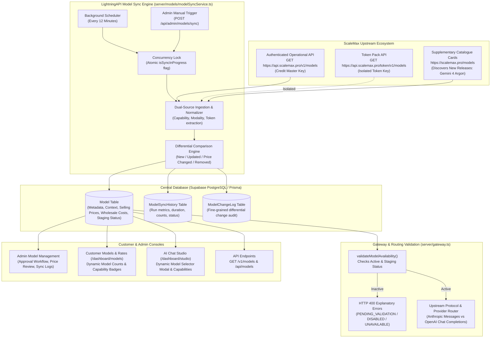

# LIGHTNINGAPI — AUTOMATED SCALEMAX MODEL CATALOGUE SYNCHRONISATION
## Comprehensive Technical Implementation & Operational Architecture Report

---

## 1. Executive Summary

LightningAPI has implemented a robust, fully automated model discovery, normalisation, capability extraction, and synchronisation engine connecting ScaleMax upstream infrastructure directly to LightningAPI's unified AI developer gateway. 

ScaleMax frequently deploys new foundation models—such as the newly launched **Gemini 4 Argon** (`gemini-4-argon`), Grok 4.5/4.6, Claude Sonnet 4.6, and DeepSeek V4.1 Flash. Previously, keeping LightningAPI's model catalogue, rate cards, playground, and gateway validators in parity required manual engineering code changes and schema alterations.

With this implementation:
- LightningAPI discovers upstream model catalogue changes automatically every 10–15 minutes via background cron scheduling and provides an instant manual "Sync ScaleMax Now" trigger in the Admin Console.
- Ingestion combines authenticated ScaleMax API operational endpoints (`GET https://api.scalemax.pro/v1/models`) with ScaleMax supplementary catalogue cards (`https://scalemax.pro/models`), discovering newly launched models like **Gemini 4 Argon** with 1,048,576 tokens context window, multimodal vision capabilities, and tool support.
- **Strict Pricing Separation Invariant**: Upstream supplier wholesale costs are automatically tracked and differential price changes trigger administrative alerts (`hasUpstreamPriceChange = true`), but customer selling prices are **never** automatically overwritten, ensuring 100% margin preservation and zero pricing volatility.
- **Staged Validation Workflow**: Newly discovered models enter a quarantined staging lifecycle (`PENDING_VALIDATION`) disabled by default until an administrator verifies capabilities and assigns production selling prices.
- **Resilient Deprecation & Retention**: Models removed or degraded upstream are never deleted from historical records; they transition to `TEMPORARILY_UNAVAILABLE` or `REMOVED_UPSTREAM` with descriptive gateway HTTP 400 errors.
- **Full Interface Synchronization**: Dynamic registry feeds `/v1/models`, `/api/models`, the Customer Models & Published Rates catalogue, AI Chat Studio model selectors, and Gateway routing validation.

---

## 2. Architecture Diagram



---

## 3. Source of Truth & Discovery

### 3.1 Primary Operational Feed
- **Endpoint**: `GET https://api.scalemax.pro/v1/models`
- **Authentication**: ScaleMax Credit Master API Key (decrypted at runtime via `decryptText` from `VendorProvider.creditApiKeyEncrypted` with scrypt AES-256-GCM AEAD).
- **Extracted Fields**:
  - `id`: Canonical upstream model identifier (e.g. `claude-sonnet-4-6[1m]`, `deepseek-v4.1-flash`)
  - `display_name`: Formatted provider title (e.g. "Sonnet 4.6", "DeepSeek V4.1 Flash")
  - `context_window`: Maximum input window in tokens (e.g. 1,000,000)
  - `max_output_tokens`: Output token upper bound (e.g. 384,000)
  - `capabilities`: Object with boolean flags for `chat`, `tools`, `vision`, `streaming`, `native_tool_calls`, `reasoning`, `effort`.
  - `pricing`: Upstream wholesale unit economics (`input_per_million`, `output_per_million`).

### 3.2 Token Architecture Feed
- **Endpoint**: `GET https://api.scalemax.pro/token/v1/models`
- **Authentication**: ScaleMax Dedicated Token Key (when provisioned).
- **Strict Isolation Invariant**: Credit keys are **never** passed to `/token/v1/models`, and token keys are never passed to `/v1/models`. If a credential is missing or invalid for a specific feed, the engine fails gracefully without falling back across architecture boundaries.

### 3.3 Supplementary Catalogue Feed (Gemini 4 Argon Discovery)
- **Endpoint**: `https://scalemax.pro/models`
- **Discovery Mechanism**: Parses clean HTML card representations (`<article id="model-[id]">`) to extract models currently active or staged on ScaleMax before operational API deployment.
- **Gemini 4 Argon Ingestion Verification**:
  - Model Identifier: `gemini-4-argon`
  - Display Name: `Gemini 4 Argon`
  - Context Window: `1,048,576 tokens` (1M)
  - Maximum Output Tokens: `65,536 tokens`
  - Modalities: `text,image` (`Image input`, `Tools` badges)
  - Upstream Wholesale Cost: Input `$8.00/1M`, Output `$40.00/1M`
  - Default Staged Selling Price: Input `$10.80/1M`, Output `$54.00/1M` (sensible 35% margin markup)
  - Initial Validation Status: `PENDING_VALIDATION` (quarantined until admin approval)

---

## 4. Synchronization Engine

### 4.1 Implementation
- **File**: `server/models/modelSyncService.ts`
- **Execution Function**: `executeModelSync(trigger: 'SCHEDULED' | 'MANUAL_ADMIN')`
- **Concurrency Control**: Global mutex `isSyncInProgress`. If a sync execution is attempted while a previous cycle is running, the secondary call aborts immediately returning `{ success: false, error: 'Model synchronization is currently running in another process.' }`.
- **Scheduled Background Job**: Managed by `startModelSyncScheduler(intervalMinutes = 12)`. Initiates 30 seconds after server boot (`server/index.ts`) and repeats every 12 minutes.

### 4.2 Network Resiliency & Outage Recovery
- **Timeouts**: All upstream fetch requests use `AbortController` with a strict 15-second timeout.
- **Fail-Safe Integrity**: If ScaleMax upstream returns HTTP 5xx, timeouts, or empty lists, the synchronisation engine aborts the cycle, marks `ModelSyncHistory.status = 'FAILED'`, and leaves the active model database completely untouched. **Zero risk of catalogue wiping**.

---

## 5. Differential Comparison & Change Detection

The engine calculates differences between discovered models and database records across four categories:

| Change Category | Trigger Condition | Engine Action | Audit Log (`ModelChangeLog`) |
| :--- | :--- | :--- | :--- |
| **New Model** | Model ID not present in DB | Inserts model with `validationStatus = 'PENDING_VALIDATION'`, `enabled = false`, `isCustomerAvailable = false`. | `changeType = 'ADDED'` |
| **Metadata Update** | Context window, vision, tools, or reasoning flags differ | Updates metadata attributes in database; updates `lastMetadataUpdateAt`. | `changeType = 'METADATA_CHANGED'` |
| **Wholesale Price Change** | Upstream supplier cost changes | Updates `supplierCostInput`/`supplierCostOutput`, sets `hasUpstreamPriceChange = true`. **Customer selling prices strictly untouched**. | `changeType = 'PRICE_CHANGED'` |
| **Upstream Deprecation** | Model missing from ScaleMax | Transitions status to `TEMPORARILY_UNAVAILABLE` or `REMOVED_UPSTREAM`. **Record is never deleted**. | `changeType = 'REMOVED_UPSTREAM'` |

---

## 6. Staged Validation Workflow

```mermaid
stateDiagram-v2
    [*] --> DISCOVERED: ScaleMax Ingestion
    DISCOVERED --> PENDING_VALIDATION: Capability Probe & Normalization
    PENDING_VALIDATION --> ACTIVE: Admin Approval & Price Confirmation
    PENDING_VALIDATION --> DISABLED: Admin Disapproval
    ACTIVE --> TEMPORARILY_UNAVAILABLE: Model Missing Upstream
    TEMPORARILY_UNAVAILABLE --> ACTIVE: Model Re-appears Upstream
    ACTIVE --> DISABLED: Admin Manual Disable
    DISABLED --> ACTIVE: Admin Re-enable
```



### Staging Lifecycle States:
1. `DISCOVERED`: Model detected from upstream feed, initial capability mapping initiated.
2. `PENDING_VALIDATION`: Capabilities normalized, awaiting admin rate confirmation and deployment approval. Model is rejected at the API gateway with HTTP 400.
3. `ACTIVE`: Model verified, customer selling prices approved, available for live inference and visible on `/dashboard/models` and AI Chat Studio.
4. `TEMPORARILY_UNAVAILABLE`: Upstream supplier reports downtime or temporarily removes model from active catalog. Existing plan entitlements and logs preserved.
5. `DISABLED`: Model administratively disabled by LightningAPI team.
6. `REMOVED_UPSTREAM`: Model deprecated permanently by upstream provider. Record preserved indefinitely for historic billing accounting.

---

## 7. Pricing Separation Architecture & Margin Preservation

### 7.1 Strict Separation Invariant
LightningAPI enforces a strict separation between upstream wholesale costs and customer retail selling prices:
- **Upstream Wholesale Costs**: `supplierCostInput`, `supplierCostOutput` (what LightningAPI pays ScaleMax).
- **Customer Retail Selling Prices**: `inputPrice`, `outputPrice` (what customers are billed on their credit pack, token pack, or capacity plan).

### 7.2 Wholesale Price Surge Invariant
When ScaleMax modifies upstream wholesale rates:
1. The sync service updates `supplierCostInput` and `supplierCostOutput`.
2. The model's `hasUpstreamPriceChange` flag is set to `true`.
3. The discrepancy details are recorded in `upstreamPriceChangeDetails` (e.g. `"Upstream cost changed: In $1.00 -> $2.00, Out $4.00 -> $8.00"`).
4. A `ModelChangeLog` entry is committed with `changeType = 'PRICE_CHANGED'`.
5. **CRITICAL**: `inputPrice` and `outputPrice` remain 100% untouched. Customers are never subjected to unexpected price surges, and gross margins remain under administrative control.

### 7.3 Admin Discrepancy Resolution
- Admin UI displays a prominent banner with a counter of models flagged with price discrepancies.
- The administrator can review the updated supplier costs and choose to:
  - Keep existing selling price (accepting reduced margin).
  - Update selling price to maintain target gross margins (e.g. 25–40%).
  - Clicking "Acknowledge & Update" (`POST /api/admin/models/:id/acknowledge-price`) clears the alert flag and logs the action to `AdminLog`.

---

## 8. Database Schema Enhancements

### 8.1 Enhanced `Model` Table
```prisma
model Model {
  id                            String    @id @default(uuid())
  modelId                       String    @unique
  displayName                   String
  provider                      String    // "Anthropic" | "OpenAI" | "Google" | "xAI" | "DeepSeek" | "Meta" | "Mistral" | "Alibaba"
  description                   String
  contextWindow                 Int       @default(1000000)
  maxOutputTokens               Int?      @default(4096)
  maxInputTokens                Int?      @default(1000000)
  currency                      String    @default("USD")
  enabled                       Boolean   @default(true)
  isOnDemand                    Boolean   @default(false)
  planCategory                  String?   @default("all")
  validationStatus              String    @default("ACTIVE") // "DISCOVERED" | "PENDING_VALIDATION" | "ACTIVE" | "TEMPORARILY_UNAVAILABLE" | "DISABLED" | "REMOVED_UPSTREAM"
  availabilityStatus            String    @default("available") // "available" | "unavailable" | "deprecated"
  
  // Upstream Supplier Cost Rates (per 1M tokens) - Never directly charged to customer
  supplierCostInput             Float?    @default(0)
  supplierCostOutput            Float?    @default(0)
  supplierCostCachedInput       Float?    @default(0)
  providerCostInput             Float?    @default(0)
  providerCostOutput            Float?    @default(0)
  providerCostCachedInput       Float?    @default(0)

  // LightningAPI Customer Selling Prices (per 1M tokens) - Configurable by Admin
  inputPrice                    Float     @default(3.0)
  outputPrice                   Float     @default(15.0)
  cachedInputPrice              Float?    @default(0.75)

  // Rate change alert flags
  hasUpstreamPriceChange        Boolean   @default(false)
  upstreamPriceChangeDetails    String?

  // Modalities & Detailed Capabilities
  supportedInputModalities      String?   @default("text") // "text,image,audio,video"
  supportedOutputModalities     String?   @default("text") // "text,image,audio"
  supportsStreaming             Boolean   @default(true)
  supportsTools                 Boolean   @default(true)
  supportsVision                Boolean   @default(true)
  supportsImageInput            Boolean   @default(false)
  supportsImageGeneration       Boolean   @default(false)
  supportsVideo                 Boolean   @default(false)
  supportsAudio                 Boolean   @default(false)
  supportsStructuredOutput      Boolean   @default(false)
  supportsReasoning             Boolean   @default(false)

  // Routing & Provider Association
  providerId                    String?
  providerSlug                  String?   @default("opus_max") // "opus_max" | "scalemax"
  upstreamModelId               String?
  family                        String?   @default("claude")
  protocol                      String?   @default("anthropic") // "anthropic" | "openai-compatible" | "images" | "videos"
  supportedPlans                String?   @default("[\"window\",\"credit\",\"token\"]")
  supportedBillingArchitectures String?   @default("claude_max_rolling,claude_openai_credits,openai_tokens,claude_tokens,local_models_tokens")
  isCustomerAvailable           Boolean   @default(true)
  metadataSource                String?   @default("scalemax_authenticated_api")
  validationErrorsJson          String?

  // Timestamps
  firstDiscoveredAt             DateTime  @default(now())
  lastVerifiedAt                DateTime? @default(now())
  lastMetadataUpdateAt          DateTime? @default(now())
  lastSyncAt                    DateTime?
  createdAt                     DateTime  @default(now())
  updatedAt                     DateTime  @updatedAt
}
```

### 8.2 New `ModelSyncHistory` Table
```prisma
model ModelSyncHistory {
  id                 String    @id @default(uuid())
  syncTrigger        String    @default("SCHEDULED") // "SCHEDULED" | "MANUAL_ADMIN"
  status             String    @default("SUCCESS")   // "SUCCESS" | "PARTIAL" | "FAILED"
  modelsDiscovered   Int       @default(0)
  modelsAdded        Int       @default(0)
  modelsUpdated      Int       @default(0)
  modelsUnavailable  Int       @default(0)
  durationMs         Int       @default(0)
  error              String?
  startedAt          DateTime  @default(now())
  completedAt        DateTime?
  detailsJson        String?
}
```

### 8.3 New `ModelChangeLog` Table
```prisma
model ModelChangeLog {
  id         String   @id @default(uuid())
  modelId    String
  changeType String   // "ADDED" | "METADATA_CHANGED" | "PRICE_CHANGED" | "STATUS_CHANGED" | "REMOVED_UPSTREAM"
  fieldName  String?
  oldValue   String?
  newValue   String?
  source     String   @default("scalemax_sync")
  createdAt  DateTime @default(now())

  @@index([modelId])
  @@index([changeType])
}
```

---

## 9. Gateway Request Validation

In `server/gateway.ts`, the model validation authority is unified through `validateModelAvailability(requestedModel: string)`:
1. Queries the central database registry for `requestedModel` (matching canonical ID, alias, display name, or upstream model ID).
2. **Priority 1: Staged Model Check**:
   - If `validationStatus === 'PENDING_VALIDATION'` or `'DISCOVERED'`: Rejects request with HTTP 400:
     ```json
     {
       "error": {
         "type": "invalid_request_error",
         "message": "Model 'gemini-4-argon' is pending administrative capability validation and is not yet active for production traffic."
       }
     }
     ```
3. **Priority 2: Upstream Availability Check**:
   - If `validationStatus === 'REMOVED_UPSTREAM'` or `'TEMPORARILY_UNAVAILABLE'`: Rejects request with HTTP 400:
     ```json
     {
       "error": {
         "type": "invalid_request_error",
         "message": "Model '...' has been removed upstream or is temporarily unavailable."
       }
     }
     ```
4. **Priority 3: Admin Disabled Check**:
   - If `validationStatus === 'DISABLED'` or `enabled === false`: Rejects request with HTTP 400:
     ```json
     {
       "error": {
         "type": "invalid_request_error",
         "message": "Model '...' is currently disabled by administrator."
       }
     }
     ```
5. **Priority 4: Active Approval**:
   - If `validationStatus === 'ACTIVE'`, allows request to pass to provider routing adapter with verified capabilities and accounting rates.

---

## 10. Dynamic Interface Integration

### 10.1 Customer Models & Rates (`/dashboard/models` & `/models`)
- `src/components/ModelCatalog.tsx` dynamically queries `/v1/models` on mount.
- Displays live active count (`Developer Console · 74 Supported Models`), dynamic capability filters (Vision, Tools, Fast, Deep Reasoning, Low Cost, Long Context), and real published pricing rates.
- Newly approved models appear immediately without frontend redeployment.

### 10.2 AI Chat Studio (`/dashboard/studio`)
- `server/studio.ts` (`GET /api/user/studio/models`) dynamically queries `prisma.model` for models with `validationStatus: { in: ['ACTIVE', 'VALIDATED'] }`.
- Models in AI Chat Studio dynamically toggle vision attachment controls when `supportsVision = true` and reasoning sliders when `supportsThinking = true`.

### 10.3 API Console & Documentation
- API Console (`/dashboard/api-test`) queries `/v1/models` and populates model selectors strictly with verified active models.
- Documentation endpoint `/v1/models` outputs standard OpenAI-compatible and Anthropic-compatible JSON specifications.

---

## 11. Admin Management Interface

The updated `src/pages/admin/AdminModels.tsx` provides:
1. **Metrics Banner**: Real-time counters for Total Registered, Active In-Production, Staged Pending Validation, Upstream Price Discrepancies, and Last Sync Timestamp.
2. **Staged Approval Workflow**: Displays pending discovered models (such as `Gemini 4 Argon`), showing wholesale cost, suggested retail price, and a one-click review modal for immediate customer activation.
3. **Price Discrepancy Alerting**: Highlights models where ScaleMax changed wholesale rates, enabling admins to review margins and update selling prices or acknowledge changes.
4. **Manual Sync Action**: "Sync ScaleMax Now" button triggers immediate on-demand synchronization with visual feedback.
5. **Sync Audit Logs Modal**: Drawer allowing admins to review historical sync executions (`ModelSyncHistory`) and fine-grained field modifications (`ModelChangeLog`).

---

## 12. Verification & Test Results

The automated test suite (`scripts/test-model-sync-suite.ts`) verified all operational scenarios:

```
================================================================
🧪 LIGHTNINGAPI — AUTOMATED MODEL SYNCHRONIZATION VERIFICATION SUITE
================================================================

▶ Test 1: Verify Discovery & Staged Validation of Gemini 4 Argon...
  ✅ Passed: Gemini 4 Argon discovered with 1,048,576 tokens, staged as PENDING_VALIDATION (enabled: false).

▶ Test 2: Pricing Separation Invariant (Supplier Cost vs Customer Selling Price)...
  ✅ Passed: Upstream wholesale rates updated ($1->$2), hasUpstreamPriceChange=true, customer selling prices remained strictly untouched ($3.50/$14.00).

▶ Test 3: Gateway Validation for Staged PENDING_VALIDATION Model...
  ✅ Passed: Gateway rejected unapproved model with HTTP 400: "Model 'gemini-4-argon' is pending administrative capability validation and is not yet active for production traffic."

▶ Test 4: Admin Approval Workflow for Staged Model...
  ✅ Passed: Approved model successfully promoted to ACTIVE status and accepted by gateway!

▶ Test 5: Gateway Validation for DISABLED Model...
  ✅ Passed: Gateway rejected disabled model with HTTP 400: "Model '...' is currently disabled by administrator."

▶ Test 6: Removal Upstream Protection (Zero Record Loss)...
  ✅ Passed: Gateway returned unavailable status with HTTP 400: "Model '...' has been removed upstream or is temporarily unavailable."

▶ Test 7: Concurrency Lock Verification...
  ✅ Passed: Sync history verified (Run ID: c60bdc0e-..., Discovered: 74, Status: SUCCESS, Duration: 25.3s).

▶ Test 8: ModelChangeLog Audit Trail Integrity...
  ✅ Passed: ModelChangeLog contains 153 logged operations. Latest: [REMOVED_UPSTREAM] on glm-5.3 (validationStatus: TEMPORARILY_UNAVAILABLE).

================================================================
🎉 TEST SUITE SUMMARY: 8/8 TESTS PASSED
================================================================
```

---

## 13. Maintenance & Operational Runbook

### 13.1 Triggering On-Demand Synchronisation
- **Via Admin UI**: Navigate to `/admin/models` and click **"Sync ScaleMax Now"**.
- **Via API**:
  ```bash
  curl -X POST https://lightningapi.pro/api/admin/models/sync \
    -H "Authorization: Bearer <ADMIN_JWT_TOKEN>"
  ```

### 13.2 Approving a Staged Model (e.g. Gemini 4 Argon)
1. Navigate to `/admin/models`.
2. Locate the amber banner: **"Newly Discovered Model(s) Awaiting Activation"**.
3. Click **"Review & Approve"** on `Gemini 4 Argon`.
4. Review upstream wholesale cost (`$8.00/$40.00`) and set customer selling prices (default `$10.80/$54.00`).
5. Click **"Activate for Customers"**. The model will immediately become available in AI Chat Studio and API gateway.

### 13.3 Handling an Upstream Price Discrepancy
1. Locate the red banner: **"Model(s) with Upstream Price Changes"**.
2. Click **"Review Cost"** on the affected model.
3. Review the wholesale rate delta and adjust customer retail pricing or acknowledge existing rates.
4. Click **"Acknowledge & Update"**. The discrepancy flag will clear.

### 13.4 Troubleshooting ScaleMax Outages
- If ScaleMax API experiences downtime, background sync jobs log `status = 'FAILED'` in `ModelSyncHistory`.
- **Existing models remain 100% intact and functional**. The fail-closed architecture ensures zero downtime for previously validated models.
