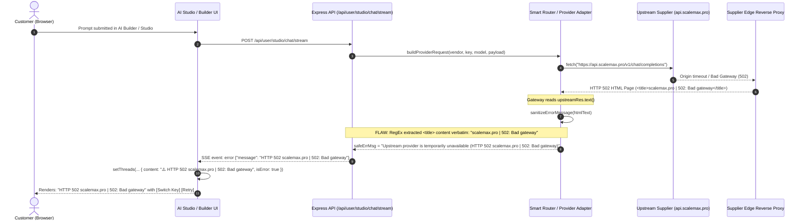

# LIGHTNINGAPI — SUPPLIER INFORMATION LEAKAGE ROOT CAUSE REPORT

**Incident Classification: CRITICAL SECURITY & UPSTREAM ISOLATION DEFECT**  
*Document Version: 1.0.0*  
*Timestamp: 2026-11-02T16:15:00+05:30*  
*Branch: `feature/five-plan-architecture-and-pricing`*  
*Report Status: Complete Root Cause Identification & Architectural Remediation Roadmap*

---

## 1. Executive Summary & Incident Reproduction

A live customer encountered an error in the LightningAPI AI Studio / Website Builder displaying the exact raw message:
```text
HTTP 502 scalemax.pro | 502: Bad gateway
[Switch Key] [Retry]
```

This incident represents a severe breach of **Strict Supplier Information Isolation**. Customers must interact exclusively with LightningAPI. Upstream suppliers (`ScaleMax`, `OpusMax`, `LotusAI`), supplier domains (`scalemax.pro`, `api.scalemax.pro`, `api.lotusai.pro`), and internal routing topology must remain strictly confidential and completely undetectable through any customer-facing surface or network response.

### Core Findings
1. **The Exact Extraction Vector**: When an upstream supplier gateway returns an HTTP 502/504 error page, the reverse proxy (Cloudflare/Nginx) delivers an HTML document containing:
   ```html
   <!DOCTYPE html>
   <html>
   <head><title>scalemax.pro | 502: Bad gateway</title></head>
   ...
   ```
2. **Defective Sanitizer Early-Exit**: In `server/providers/responseSanitizer.ts` (lines 89–96), the HTML error extraction logic matched the `<title>` tag and extracted `scalemax.pro | 502: Bad gateway`, immediately returning:
   ```typescript
   return `Upstream provider is temporarily unavailable (HTTP ${code} ${title}). Please retry shortly.`;
   ```
   This returned **early** before string scrubbers ran, directly leaking the supplier's private domain (`scalemax.pro`) into the customer-facing error payload.
3. **Frontend Direct Rendering**: In `src/pages/dashboard/UserChatStudio.tsx` (lines 2143–2172 and 2430) and `src/pages/dashboard/UserWebsiteBuilder.tsx` (lines 289–299), incoming backend error strings were rendered directly into the chat thread and activity banner without frontend classification.
4. **Non-Contextual UI Actions**: The frontend indiscriminately displayed a **"Switch Key"** button alongside "Retry" for an HTTP 502 infrastructure failure, misleading the customer into believing their personal API key was defective when the issue was an upstream supplier outage.
5. **Additional Header & Metadata Leaks Discovered**:
   - `x-lightning-routed-provider` was emitted in HTTP response headers across `server/gateway.ts` (e.g., lines 1625, 1958, 2242, 2769, 3040, 3162, 3321), exposing values such as `scalemax` and `lotusai` in plain text to anyone inspecting browser network headers.
   - `server/gateway.ts` line 3419 contained hardcoded text: `'Request timed out waiting for LotusAI upstream response.'`.
   - `server/models/modelSyncService.ts` lines 214, 316, 366, 406 generated model catalog descriptions containing `"via ScaleMax enterprise network"`.

---

## 2. End-to-End Request & Failure Trace

Below is the verified end-to-end trace of how `scalemax.pro` traveled from the upstream infrastructure to the customer's display:



### Trace Step Analysis

| Trace Step | File & Location | Vulnerability Description |
| :--- | :--- | :--- |
| **1. Upstream 502 Response** | Cloudflare Edge / `api.scalemax.pro` | Returned raw HTML error document with upstream hostname in the title. |
| **2. Upstream Response Ingestion** | `server/studio.ts` (line 2774) & `server/gateway.ts` (line 1911) | Response body read as raw text without schema validation or HTML stripping. |
| **3. Flawed Title Extraction** | `server/providers/responseSanitizer.ts` (line 91) | RegEx `result.match(/<title>([^<]+)<\/title>/i)` captured the domain verbatim. |
| **4. Early-Exit Without Scrubbing** | `server/providers/responseSanitizer.ts` (line 95) | Returned extracted title immediately, bypassing domain and brand scrubbers on lines 106–129. |
| **5. SSE Error Event Packaging** | `server/studio.ts` (line 2781) | Emitted raw unsanitized error message via `sendSse('error', { message: safeErrMsg })`. |
| **6. Frontend State Ingestion** | `src/pages/dashboard/UserChatStudio.tsx` (line 2171, 2419) | Received error event and directly assigned `err.message` to message content. |
| **7. Display & Misleading Actions** | `src/pages/dashboard/UserChatStudio.tsx` (line 4066) | Rendered `Switch Key` and `Retry` regardless of error status code (offering key switch on a 502). |

---

## 3. Platform-Wide Leakage Vulnerability Audit

A comprehensive static and dynamic code audit was executed across all backend and frontend layers to identify every direct and indirect leakage vector:

### 3.1 HTTP Response Headers (`x-lightning-routed-provider`)
In `server/gateway.ts`, seven distinct locations set the response header:
```typescript
res.setHeader('x-lightning-routed-provider', routeResolution.providerSlug || 'unknown');
```
When routed through ScaleMax or LotusAI, the browser Network tab revealed:
`x-lightning-routed-provider: scalemax` or `x-lightning-routed-provider: lotusai`.  
**Remediation**: Completely eliminate supplier-revealing headers from customer-facing responses. Replace with customer-safe metadata (e.g. `x-lightning-engine: neural-mesh`).

### 3.2 Hardcoded Error Strings
In `server/gateway.ts` line 3419:
```typescript
message: isTimeout ? 'Request timed out waiting for LotusAI upstream response.' : ...
```
**Remediation**: Replace with centralized, branded failure messaging: `'The request took too long to complete. Please try again shortly.'`.

### 3.3 Dynamic Model Catalogue Descriptions
In `server/models/modelSyncService.ts` lines 214, 316, 366, 406:
Strings were synthesized containing:
`"high-performance AI model via ScaleMax network."` and `"via ScaleMax enterprise network."`.  
If synced into the public model database, these strings were returned directly by `/v1/models`.  
**Remediation**: Purge all vendor references from model discovery sync. Rebrand all descriptions to `"via LightningAPI High-Throughput Edge Mesh"`.

### 3.4 Provider Adapter Base URLs & Request Passthrough
In `server/providerAdapter.ts` (lines 399–408, 598–604), error normalization relied on rudimentary `.replace()` string substitution. If an upstream error contained subdomains (e.g., `api2.scalemax.pro`, `dashboard.opusmax.pro`, `token.scalemax.pro`), partial matches or unlisted subdomains bypassed the scrubbers.  
**Remediation**: Implement a strict, non-bypassable Central Error Normalizer that translates errors by category rather than relying on regex string replacement.

---

## 4. Architectural Remediation Strategy

To permanently eliminate supplier leakage across all six billing architectures, the system will implement the following defensive tiers:

```
[Upstream Supplier]
       │
       ▼ (Raw Response / 502 HTML / Network Error)
[Tier 1: Upstream Ingestion & Raw Log Isolation]
       │  • Raw upstream error logged ONLY to secure Admin Audit Store
       │  • Supplier credentials and raw hostnames stripped from telemetry
       ▼
[Tier 2: Central Error Normalization Engine]
       │  • Classifies error deterministically (STATUS_CODE + INTERNAL_CAUSE)
       │  • Maps to controlled, LightningAPI-branded customer messages
       │  • Strips all HTML, titles, hostnames, and stack traces
       │  • Enforces explicit customer-safe JSON schema (ZERO passthrough fields)
       ▼
[Tier 3: Header & Streaming Gate]
       │  • Strips x-lightning-routed-provider and supplier headers
       │  • Intercepts SSE error events and sanitizes before flush
       ▼
[Tier 4: Frontend Protective Normalizer]
       │  • Frontend validates all error displays against safe schemas
       │  • Context-aware action buttons:
       │      - 502/503/504 -> [Retry with Backoff] (NO Switch Key)
       │      - 401/403/Quota -> [Switch Key] / [Recharge]
       ▼
[Customer Display (100% LightningAPI Branded)]
```

This multi-layer architecture guarantees that even if an upstream provider introduces new domain names or error formats, no raw supplier data can ever reach a customer.
