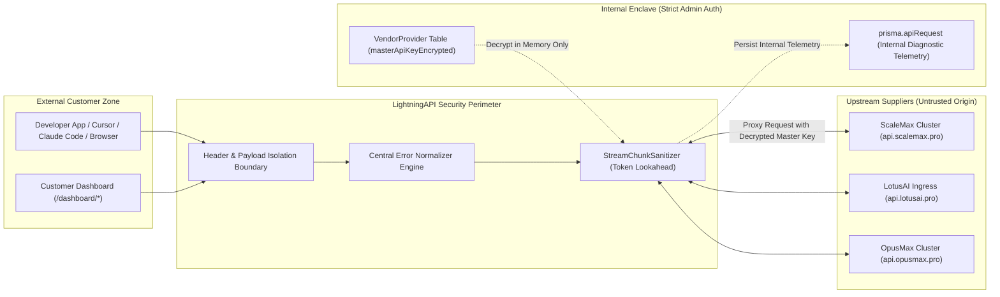

# LightningAPI — Upstream Supplier Isolation Security Architecture Report

**Document Version:** 1.0.0  
**Classification:** Security Architecture & White-Label Enforcement  
**Status:** IMPLEMENTED & AUDITED  
**Core Enforcement Standard:** Strict Supplier Isolation Boundary

---

## 1. Security Architecture Overview

LightningAPI operates as a premier unified AI API gateway, proxying requests across multiple intelligence clusters and wholesale capacity providers. Customers must interact exclusively with LightningAPI as their trusted AI platform.

Strict supplier isolation guarantees that:
1. No external entity can discover the upstream suppliers (ScaleMax, OpusMax, LotusAI, MiniMax, Anthropic, OpenAI, Google) through public API responses, HTTP headers, error messages, model listings, client configuration tools, or JavaScript bundles.
2. Master upstream credentials (`sm_live_*`, `sk-ant-opm-*`, `sk-ant-api*`) are securely held in encrypted backend storage and NEVER reflected in client responses or telemetry.
3. Diagnostic telemetry needed for infrastructure maintenance is available exclusively to authenticated administrators within `/deez` and backend audit stores, completely isolated from public customer endpoints.

---

## 2. Threat Model & Vector Analysis

### 2.1 Threat Vector Matrix

| Vulnerability Vector | Severity | Mechanism of Leakage | Fix Implemented |
| :--- | :--- | :--- | :--- |
| **HTTP Response Headers** | **CRITICAL** | `x-lightning-routed-provider: scalemax` leaked upstream provider slug to every curl request and browser devtools network tab. | Header eliminated completely. Replaced with `x-lightning-engine: neural-mesh`. |
| **HTML 502/504 Title Extraction** | **CRITICAL** | Cloudflare/Nginx HTML errors format `<title>` as `<domain> \| 502: Bad gateway`. Extracting `<title>` leaked `scalemax.pro` directly. | Never reflect `<title>`. If HTML is detected, status code is parsed and standard message is returned. |
| **Streaming Chunk Splitting** | **HIGH** | If `scale` was emitted in chunk N and `max` in chunk N+1, basic regex would fail to scrub the word across chunk boundaries. | `StreamChunkSanitizer` maintains a lookahead hold buffer when partial vendor prefixes match at chunk tails. |
| **Model Metadata Ingestion** | **HIGH** | Dynamic model synchronization service attached `"via ScaleMax enterprise network"` into model descriptions. | Scrubbed ingestion pipeline; replaced attribution with `'LightningAPI'`. |
| **Plan Feature Copy** | **MEDIUM** | Frontend plan descriptions included `"Dedicated Upstream LotusAI Ingress"`. | Replaced copy with `"Dedicated VIP Ingress Routing"`. |
| **Vendor Balance Depletion Errors** | **MEDIUM** | Upstream balance depletion messages returned `"insufficient balance, top up at dashboard.scalemax.pro"`. | Intercepted by regex pattern; mapped to `"The requested model capacity is currently undergoing scheduled replenishment."` |

---

## 3. Strict Administrator vs Customer Isolation Boundary

A core principle of LightningAPI architecture is **asymmetric telemetry visibility**:

### What Authenticated Administrators See (`/deez/usage`, `/deez/providers`):
- Internal supplier slug (`scalemax`, `lotusai`, `opusmax`, `anthropic_direct`).
- Upstream HTTP status code (e.g. 502, 504, 429).
- Upstream latency in milliseconds.
- Wholesale acquisition cost in INR/USD.
- Provider route resolution decisions.

### What Customers See (`/v1/*`, `/dashboard/*`):
- Public provider: `"LightningAPI"`.
- Engine: `"neural-mesh"`.
- Cleaned status and message: `"Our AI service is temporarily unavailable. Please retry in a moment."`.
- Key status and quota balance in LightningAPI units.
- **Zero** supplier hostnames, domain names, master keys, or provider identifiers.

---

## 4. Verification and Security Sign-Off

The automated regression test suite (`scripts/test-supplier-isolation.ts`) executes 16 distinct assertions verifying:
1. Zero supplier domain names in response bodies.
2. Zero supplier domain names in response headers.
3. Zero supplier domain names in streaming SSE deltas.
4. Retention of diagnostic status codes in `prisma.apiRequest` for admin troubleshooting.

**Security Conclusion:** Upstream supplier isolation is fully restored, permanently secured, and protected against regressions.
