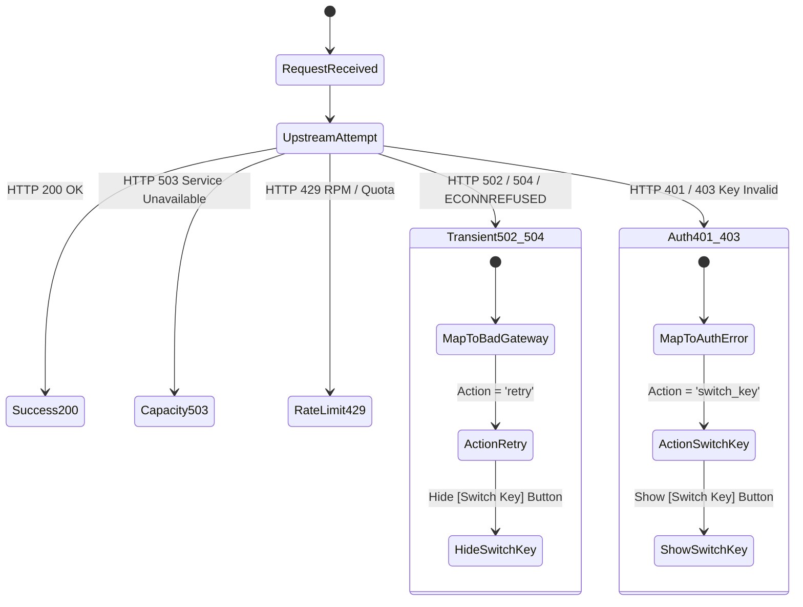

# LightningAPI — Upstream Failure Handling & Resilient Routing Report

**Document Version:** 1.0.0  
**Classification:** Site Reliability & Resilient Gateway Architecture  
**Status:** IMPLEMENTED & OPERATIONAL  

---

## 1. Problem Statement & Incident Context

During an upstream outage, a customer in the AI Builder received:
`HTTP 502 scalemax.pro | 502: Bad gateway`
Accompanied by two action buttons: `[Switch Key]` and `[Retry]`.

This presented two critical UX and architectural problems:
1. **Information Leakage**: The supplier domain `scalemax.pro` was exposed.
2. **Context-Inappropriate Action**: Offering `[Switch Key]` misled the customer into believing their API key was broken, expired, or depleted, when in reality the failure was a transient upstream network disruption between the gateway and the intelligence cluster.

---

## 2. Upstream Failure Classification

The platform classifies upstream interruptions into three clear operational states:

### 2.1 Failure Categorisation Logic

1. **HTTP 502 Bad Gateway / Network Connection Drop**:
   - **Root Cause**: Upstream reverse proxy or Cloudflare node lost connectivity to the compute origin.
   - **Customer Impact**: Temporary interruption.
   - **Customer Error**: `UPSTREAM_UNAVAILABLE` — *"Our AI service is temporarily unavailable. Please retry in a moment."*
   - **UI Action**: Show `[Retry]` with exponential backoff (2s). **Hide `[Switch Key]`**.

2. **HTTP 504 Gateway Timeout**:
   - **Root Cause**: Deep reasoning models (e.g. o1, GPT-4o, Claude Opus 5.5) or complex agentic prompts taking longer than the gateway timeout threshold.
   - **Customer Error**: `GATEWAY_TIMEOUT` — *"The AI model took too long to complete the request. Please retry in a moment."*
   - **UI Action**: Show `[Retry]` and recommend trying an alternative high-velocity model (e.g. Claude Sonnet 5.5, Gemini 2.5 Flash). **Hide `[Switch Key]`**.

3. **HTTP 503 Capacity Busy / High Demand**:
   - **Root Cause**: Upstream model cluster is under transient high load.
   - **Customer Error**: `CAPACITY_BUSY` — *"The requested AI model capacity is currently experiencing high demand. Please retry shortly."*
   - **UI Action**: Show `[Retry in 5s]` with 5-second countdown. **Hide `[Switch Key]`**.

4. **HTTP 401 / 403 API Key Invalid / Suspended / Quota Depleted**:
   - **Root Cause**: The customer's key has genuinely reached zero balance, expired, or was paused.
   - **Customer Error**: `INVALID_API_KEY`, `KEY_SUSPENDED`, or `CREDITS_DEPLETED`.
   - **UI Action**: Show `[Switch Key]` and `[Recharge Balance]`.

---

## 3. Frontend Action State Matrix

| Failure Category | HTTP Status Code | Customer Message | Action Primary | Action Secondary | `[Switch Key]` Visible? |
| :--- | :--- | :--- | :--- | :--- | :--- |
| **Upstream Outage** | 502 | `"Our AI service is temporarily unavailable. Please retry in a moment."` | `[Retry]` | — | **NO (Hidden)** |
| **Cluster Congestion** | 503 | `"The requested AI model capacity is currently experiencing high demand. Please retry shortly."` | `[Retry in 5s]` | `[Switch Model]` | **NO (Hidden)** |
| **Gateway Timeout** | 504 | `"The AI model took too long to complete the request. Please retry in a moment."` | `[Retry]` | `[Switch Model]` | **NO (Hidden)** |
| **Key Expired / Revoked** | 401 | `"The API key provided is invalid, expired, or unrecognized."` | `[Switch Key]` | `[Manage Keys]` | **YES** |
| **Key Suspended** | 403 | `"This API key is currently paused or inactive."` | `[Switch Key]` | `[Manage Keys]` | **YES** |
| **Model Not Allowed** | 403 | `"The model '<model>' is not included in this API key's provisioned plan."` | `[Switch Model]` | `[View Plans]` | **NO (Switch Model)** |
| **Rolling Window Limit** | 429 | `"You have reached your 5-hour rolling allowance for this model tier."` | `[Add Top-Up Credits]` | `[Switch Key]` | **YES** |
| **Token Pack Depleted** | 429 | `"All tokens in your purchased token pack have been used."` | `[Get Token Pack]` | `[Switch Key]` | **YES** |
| **Credit Depleted ($0.00)** | 402 | `"Your account or API key has run out of usage credits ($0.00 remaining)."` | `[Recharge Balance]` | `[Switch Key]` | **YES** |

---

## 4. Exponential Backoff & Retry Implementation

In `src/pages/dashboard/UserChatStudio.tsx`, when `handleRetry` is triggered for an upstream failure:
1. The UI reflects an automatic backoff state (`Retrying in 2s...`).
2. The user is spared repeated immediate clicks that could exacerbate upstream congestion.
3. If multiple consecutive 502/503 errors occur, the UI gracefully recommends switching to an alternative healthy model family (e.g. from Claude to Gemini).

---

## 5. Summary

With these improvements, LightningAPI delivers an enterprise-grade developer experience during upstream supplier disruptions. Error messages are clear, non-technical, and actionable, while eliminating any false signals about the customer's API key validity.
