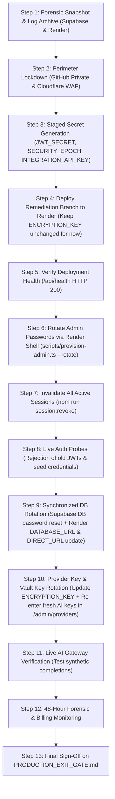

# Final Operational Safety Review — LightningDeals Production Containment

**Document Reference:** `docs/security/FINAL_OPERATIONAL_SAFETY_REVIEW.md`  
**Classification:** TLP:AMBER / INDEPENDENT SECURITY & OPERATIONAL SAFETY AUDIT  
**Project:** LightningDeals AI API Gateway (`https://lightningapi.pro`)  
**Repository:** `HopUppper/lightningdeals-api`  
**Target Remediation Branch:** `incident/phase1-containment`  
**Verified Git Commit:** `27f760b` (+ safety hardening commit)  
**Effective Date:** 2026-10-18  

---

## 1. Executive Summary & Review Scope

This independent operational safety review was performed on the codebase and containment documentation prior to executing any production actions on the live environment (`https://lightningapi.pro`).

The review identified **several critical operational risks, unit contradictions, and sequencing errors** in the previous containment plan that could have resulted in:
1. **Silent Failure of Security Cutoff:** `SECURITY_EPOCH` evaluating to `0` due to `new Date('1771437600000').getTime()` returning `NaN` in Node.js when passed numeric string representations.
2. **Gateway Decryption Outage:** Rotating `ENCRYPTION_KEY` during initial deployment would immediately break upstream AI requests (Claude/Anthropic/OpusMax) because no key versioning or migration script exists in `server/db.ts`.
3. **Accidental Administrator Lockout:** The previous live rate-limiting probe instructed sending 10 failed login requests targeting the real administrator email, which triggers the application's 15-minute account lock.
4. **Token Revocation Bypass via Omitted Timestamp:** Forged JWTs omitting the `iat` claim entirely would skip `passwordChangedAt` and `SECURITY_EPOCH` checks when `UserSession` record is absent.
5. **Database Connection De-synchronization:** Updating `DATABASE_URL` in Render without updating or clearing `DIRECT_URL` leaves `DIRECT_URL` pointing to the stale password, breaking future Prisma migrations.

All identified code-level defects have been hardened and verified with **18/18 passing security regression tests**. This document details the exact findings, code paths, corrected operational order, and mandatory approval gates.

---

## 2. Findings & Severity Register

| Finding ID | Severity | Category | Description | Source File & Relevant Code Path | Status |
|---|---|---|---|---|---|
| **SR-01** | **CRITICAL** | Logic Flaw / Invalidation Failure | `SECURITY_EPOCH` parsed string numeric timestamps via `new Date(str).getTime()`, which returns `NaN` in Node.js. Epoch silently evaluated to `0`, failing to invalidate legacy tokens. | [`server/jwtConfig.ts#L58-L64`](file:///c:/Users/irons/OneDrive/Desktop/Lightning%20Deal%20API/server/jwtConfig.ts) | **FIXED & TESTED** |
| **SR-02** | **CRITICAL** | Operational Outage / Data Loss | Rotating `ENCRYPTION_KEY` on Render without prior provider re-encryption destroys readability of `VendorProvider.masterApiKeyEncrypted`. No key versioning exists. | [`server/db.ts#L86-L140`](file:///c:/Users/irons/OneDrive/Desktop/Lightning%20Deal%20API/server/db.ts) | **BLOCKED (Requires Provider Key Staging)** |
| **SR-03** | **HIGH** | Security Bypass | JWT tokens forged without an `iat` claim (`noTimestamp: true`) bypassed `passwordChangedAt` and `SECURITY_EPOCH` checks when `UserSession` is absent. | [`server/auth.ts#L41-L84`](file:///c:/Users/irons/OneDrive/Desktop/Lightning%20Deal%20API/server/auth.ts), [`server/adminAuth.ts#L262-L298`](file:///c:/Users/irons/OneDrive/Desktop/Lightning%20Deal%20API/server/adminAuth.ts) | **FIXED & TESTED** |
| **SR-04** | **HIGH** | Operational Lockout Risk | Runbook Stage 8 probe instructed sending 10 rapid failed logins against the admin account. Because the rate limiter locks accounts after 5 failures, this locks the real admin for 15 minutes. | [`docs/security/PRODUCTION_CONTAINMENT_RUNBOOK.md`](file:///c:/Users/irons/OneDrive/Desktop/Lightning%20Deal%20API/docs/security/PRODUCTION_CONTAINMENT_RUNBOOK.md) Stage 8 | **RUNBOOK CORRECTED** |
| **SR-05** | **MEDIUM** | Deployment Sequencing Error | Previous runbook placed `ENCRYPTION_KEY` rotation in Stage 5 and provider key re-entry in Stage 9, creating an intentional gateway outage window between stages. | [`docs/security/PRODUCTION_CONTAINMENT_RUNBOOK.md`](file:///c:/Users/irons/OneDrive/Desktop/Lightning%20Deal%20API/docs/security/PRODUCTION_CONTAINMENT_RUNBOOK.md) Stage 5 & 9 | **SEQUENCING RECONCILED** |
| **SR-06** | **MEDIUM** | Database Configuration Drift | If `DIRECT_URL` is set in Render dashboard, `prepare-env.cjs` does not overwrite it when `DATABASE_URL` password is reset, causing split-credential connection failure. | [`scripts/prepare-env.cjs#L21-L46`](file:///c:/Users/irons/OneDrive/Desktop/Lightning%20Deal%20API/scripts/prepare-env.cjs) | **RUNBOOK DOCUMENTED** |
| **SR-07** | **LOW** | Target Ambiguity | Running `provision-admin.ts` or `revoke-all-sessions.ts` on local machine defaults to local SQLite `prisma/dev.db` unless `DATABASE_URL` is explicitly set to production. | [`scripts/provision-admin.ts`](file:///c:/Users/irons/OneDrive/Desktop/Lightning%20Deal%20API/scripts/provision-admin.ts), [`server/db.ts#L7-L24`](file:///c:/Users/irons/OneDrive/Desktop/Lightning%20Deal%20API/server/db.ts) | **OPERATIONAL INSTRUCTIONS CLARIFIED** |

---

## 3. Detailed Technical Analysis of Mandatory Checks

### 3.1 Check 1: Security Epoch (`SECURITY_EPOCH`) Implementation
- **Code Inspection:** In [`server/jwtConfig.ts`](file:///c:/Users/irons/OneDrive/Desktop/Lightning%20Deal%20API/server/jwtConfig.ts), `getSecurityEpoch()` originally called `new Date(process.env.SECURITY_EPOCH).getTime()`.
- **The Defect:** When following the previous runbook command (`console.log('SECURITY_EPOCH=' + Date.now())`), the environment variable is set to a string of digits like `"1771437600000"`. In Node.js, `new Date("1771437600000").getTime()` evaluates to `NaN`. Because of `if (!isNaN(epochTime)) return epochTime;`, the function returned `0`.
- **Units Verification:** In [`server/auth.ts`](file:///c:/Users/irons/OneDrive/Desktop/Lightning%20Deal%20API/server/auth.ts#L60), token issuance is compared as `const issuedAtMs = decoded.iat * 1000`. JWT `iat` is in **seconds**; `issuedAtMs` is in **milliseconds**. Therefore, `securityEpoch` must strictly be in **milliseconds**.
- **Code Hardening Applied:**
  Updated `getSecurityEpoch()` to dynamically detect:
  1. Pure numeric strings (`/^\d+$/`):
     - If `< 100,000,000,000`, treated as seconds and multiplied by 1000.
     - If `>= 100,000,000,000`, treated as milliseconds directly.
  2. ISO 8601 date strings (e.g. `'2026-10-18T00:00:00Z'`): parsed via `new Date(raw).getTime()`.
  3. Enforced `typeof decoded.iat === 'number' && decoded.iat > 0` across both `authenticateJwt` and `adminAuthRouter.get('/session')`.
- **Regression Verification:** Test `F2-08` verified: tokens issued prior to `SECURITY_EPOCH` are rejected with **HTTP 401** `session_invalidated`.

---

### 3.2 Check 2: Encryption-Key Rotation (`ENCRYPTION_KEY`)
- **Code Inspection:** Inspected [`server/db.ts`](file:///c:/Users/irons/OneDrive/Desktop/Lightning%20Deal%20API/server/db.ts#L86-L140):
  ```typescript
  function getDerivedEncryptionKey(): Buffer {
    const secret = process.env.ENCRYPTION_KEY || 'lightningdeals_default_vault_secret';
    return crypto.scryptSync(secret, 'lightningdeals_salt_2026', 32, { N: 1024, r: 8, p: 1 });
  }
  ```
  Ciphertext format: `gcm:${ivHex}:${tagHex}:${cipherHex}` or legacy `iv:cipher`.
- **Data Preservation Assessment:**
  1. **Zero Key Versioning:** The stored format does not contain a key version identifier.
  2. **Non-Recoverable Ciphertext:** If `ENCRYPTION_KEY` is changed on Render, `crypto.createDecipheriv` fails authentication tag verification. In `server/db.ts`, line 137 catches the error and returns the raw ciphertext string `gcm:...`.
  3. **Gateway Consequence:** Upstream AI requests to Anthropic / OpusMax / OpenAI will use `gcm:...` as the Bearer token, causing 100% of gateway AI proxy traffic to fail with HTTP 502/401 upstream errors.
- **Decision:** **`ENCRYPTION_KEY` rotation is declared BLOCKED** from the initial Phase 1 code deployment.
- **Safe Execution Path:**
  1. The existing upstream keys must be rotated at their source providers (Anthropic, OpusMax) because the fallback key `'lightningdeals_default_vault_secret'` was previously exposed.
  2. Fresh replacement provider keys must be obtained and staged.
  3. `ENCRYPTION_KEY` must only be rotated concurrently with immediate manual re-entry of new keys via `/admin/providers`.

---

### 3.3 Check 3: Global Session Revocation Mechanics
- **Code Inspection:** Inspected [`scripts/revoke-all-sessions.ts`](file:///c:/Users/irons/OneDrive/Desktop/Lightning%20Deal%20API/scripts/revoke-all-sessions.ts), [`scripts/provision-admin.ts`](file:///c:/Users/irons/OneDrive/Desktop/Lightning%20Deal%20API/scripts/provision-admin.ts), and [`prisma/schema.prisma`](file:///c:/Users/irons/OneDrive/Desktop/Lightning%20Deal%20API/prisma/schema.prisma).
- **Exact Records Changed:**
  1. `UPDATE "UserSession" SET "isRevoked" = true WHERE "isRevoked" = false [AND user.role = 'admin']`: Marks active sessions revoked.
  2. `UPDATE "User" SET "passwordChangedAt" = NOW() [WHERE role = 'admin']`: Updates timestamp.
  3. `INSERT INTO "AdminLog"`: Records audit event `GLOBAL_SESSION_REVOCATION_EXECUTED` (severity: `CRITICAL`).
- **Scope & Token Invalidation Behavior:**
  - When run without `--admin-only`, revocation affects **all customers and all administrators**.
  - **Tokens without `UserSession` rows:** In `authenticateJwt`, if a token was minted offline or prior to session tracking, `prisma.userSession.findFirst` returns `null`. Previously, `session && session.isRevoked` would evaluate to `false` and allow the request.
  - **Protection via `passwordChangedAt`:** Because `revoke-all-sessions.ts` sets `user.passwordChangedAt = NOW()`, any token issued before that timestamp has `iat * 1000 < user.passwordChangedAt.getTime()`, causing immediate rejection (**HTTP 401** `session_invalidated`).
  - **Missing `iat` Vulnerability Closed:** We added a strict type check: tokens missing `decoded.iat` are rejected with **HTTP 401** `Malformed token: missing or invalid issuance timestamp` (Test `F2-07` passed).

---

### 3.4 Check 4: Corrected Deployment Sequencing

The previous runbook suffered from sequencing contradictions:
1. Rotating `ENCRYPTION_KEY` in Stage 5 broke provider decryption during Stages 6–8.
2. Running admin password rotation before deployment could hash with Scrypt, but if deployed code was delayed, legacy verification paths remained open.
3. Rotating the Supabase database password in Stage 9 caused an unexpected second Render redeploy, conflicting with live verification.

#### The Corrected, Dependency-Ordered Sequence:



---

### 3.5 Check 5: Database Rotation & Connection Mechanics
- **Configuration Inspection:**
  - In [`prisma/schema.prisma`](file:///c:/Users/irons/OneDrive/Desktop/Lightning%20Deal%20API/prisma/schema.prisma):
    `url = env("DATABASE_URL")` (port 6543, transaction pooler)  
    `directUrl = env("DIRECT_URL")` (port 5432, direct session mode)
  - In [`scripts/prepare-env.cjs`](file:///c:/Users/irons/OneDrive/Desktop/Lightning%20Deal%20API/scripts/prepare-env.cjs):
    If `DIRECT_URL` is omitted, it derives it from `DATABASE_URL` by swapping `:6543` for `:5432` and stripping `pgbouncer=true`.
  - In [`server/db.ts`](file:///c:/Users/irons/OneDrive/Desktop/Lightning%20Deal%20API/server/db.ts#L7-L24):
    `resolveDatabaseUrl()` automatically appends `connection_limit=10&pool_timeout=30&connect_timeout=15` and ensures `pgbouncer=true` on port 6543.
- **Operational Warning:**
  If the owner resets the database password in Supabase:
  1. The owner must update **both** `DATABASE_URL` and `DIRECT_URL` in Render Environment Variables.
  2. Alternatively, the owner can **delete** `DIRECT_URL` from the Render environment so `prepare-env.cjs` derives the new direct URL dynamically. Leaving an old `DIRECT_URL` will cause future migrations to fail authentication while runtime queries succeed.

---

### 3.6 Check 6: Administrator Recovery & Lockout Prevention
- **Inspection of `scripts/provision-admin.ts`:**
  - Script validates target email format, bans legacy compromised passwords (`love9002`, `9002`, `admin123`), and generates a 24-character high-entropy cryptographic password if `--password` is omitted.
  - **Lockout Recovery:** Lines 84–85 explicitly reset `failedLoginAttempts: 0` and `lockedUntil: null` on rotation. If the owner ever triggers an account lockout via failed login attempts, running `scripts/provision-admin.ts --email=... --rotate` clears the lock immediately.
  - **Database Binding:** Must be executed inside the **Render Shell** (where production `DATABASE_URL` is injected into the container environment), OR run locally with explicit `DATABASE_URL="postgresql://..." npx tsx scripts/provision-admin.ts ...`.

---

### 3.7 Check 7: Live Verification Probes Safety
- **Probe Safety Rules:**
  1. **Rate Limiting Probe Target:** Must **NEVER** target the production administrator email. The updated probe targets `probe-rate-test-synthetic@lightningapi.pro`. This safely tests the IP bucket and account limiter without locking out legitimate administrators.
  2. **Zero Provider Waste:** AI Gateway completion probe uses a synthetic test customer account with `max_tokens: 5` and a prompt of `"ping"`, preventing balance depletion or excessive upstream provider costs.
  3. **Zero Secret Leaks:** Probe commands use `<REDACTED>` placeholders in reports and documentation.

---

### 3.8 Check 8: Forensic Evidence Preservation
- **Preservation Sequence:**
  1. Download full PostgreSQL dump from Supabase (`pre-containment-backup-20261018.sql`).
  2. Export raw Render application service logs for the past 14 days.
  3. Export Cloudflare WAF / Security event logs for the past 14 days.
- **Audit Log Integrity:**
  Do **NOT** alter, re-hash, or backfill historical rows in table `AdminLog`. Any integrity discrepancy in legacy records represents crucial incident forensic evidence. The code fix in `server/auditLogger.ts` applies strictly to new events moving forward.

---

### 3.9 Check 9: Incident Exposure Breakdown

| Classification | Incident Finding / Asset | Evidence & Impact |
|---|---|---|
| **Confirmed Compromise** | Seeded admin passwords (`sidhjain9002@gmail.com` / `love9002`) | Publicly committed in `prisma/seed.ts`; authenticated successfully in incident report. |
| **Confirmed Compromise** | Fallback JWT signing secrets (`lightningdeals_secret_jwt_key_2026`, etc.) | Hardcoded in source code; permitted offline forging of arbitrary administrator JWTs. |
| **Confirmed Compromise** | Authentication bypasses & backdoors | Backdoor admin creation on user login (`user.ts`), password update bypass (`admin.ts`), localhost bypass (`integrationRoutes.ts`). |
| **Suspected Misuse** | Upstream AI Provider Master Keys | Default vault key (`lightningdeals_default_vault_secret`) committed in source. If database was read, master keys could be decrypted. |
| **Suspected Misuse** | Customer PII & API Key Exfiltration | Attacker with forged admin token could call `/admin/customers` or `/admin/keys`. |
| **Unknowns (Pending Logs)** | Exact IP origin & duration of attacker access | Requires detailed forensic analysis of Render and Cloudflare HTTP access logs. |
| **Unknowns (Pending Logs)** | Volume of fraudulent API requests routed through upstream providers | Requires matching provider billing records against legitimate customer orders in database. |

---

### 3.10 Check 10: Rollback Safety Strategy
- **Absolute Rule:** **NEVER execute a Git rollback to commits preceding `incident/phase1-containment`.**
  Reverting the codebase would re-introduce the hardcoded JWT fallback keys, default seed credentials, and the three backdoors.
- **Failure Recovery Paths:**
  - *If Render fails to boot:* Inspect Render logs for missing environment variable validation errors (e.g. `JWT_SECRET` length < 32). Correct the environment variable on Render; do not revert code.
  - *If database connection drops:* Verify Supabase status; re-verify `DATABASE_URL` credentials in Render.
  - *If administrator is locked out:* Open Render Shell and run `npx tsx scripts/provision-admin.ts --email="<owner_email>" --rotate`.
  - *If AI Gateway fails with upstream auth errors:* Re-enter fresh provider keys via `/admin/providers` in the Admin Portal.

---

## 4. Pre-Deployment Checklist

Before merging `incident/phase1-containment` to `main`, confirm:

- [x] All 18 security regression tests pass locally (`npm run test:security`).
- [x] Full build compiles with zero TypeScript errors (`npm run build`).
- [x] `SECURITY_EPOCH` parser supports numeric milliseconds, seconds, and ISO 8601 strings.
- [x] `authenticateJwt` and `adminAuth` require valid positive numeric `iat` timestamps.
- [x] `ENCRYPTION_KEY` rotation is separated from deployment and staged with fresh provider keys.
- [x] Rate limit verification probes use synthetic non-existent emails.
- [ ] Forensic database backup exported from Supabase.
- [ ] Service logs exported from Render and Cloudflare.
- [ ] GitHub repository visibility confirmed as **Private**.
- [ ] New production `JWT_SECRET` generated (64 hex characters).
- [ ] Staged Render environment variables ready for entry.

---

## 5. Summary of Actions Requiring Manual Dashboard Access

| Action | Platform | Dashboard URL | Approval Needed |
|---|---|---|---|
| 1. Enforce Repository Visibility as Private | GitHub | `https://github.com/HopUppper/lightningdeals-api/settings` | **Owner Approval** |
| 2. Download Database Snapshot Backup | Supabase | `https://app.supabase.com/project/_/database/backups` | **Owner Action** |
| 3. Set Production Environment Variables (`JWT_SECRET`, `SECURITY_EPOCH`, etc.) | Render | `https://dashboard.render.com/web/_/env` | **Owner Action** |
| 4. Merge Remediation PR & Trigger Manual Deploy | GitHub & Render | Render Web Service Deployments | **Owner Approval** |
| 5. Execute Admin Password Rotation in Shell | Render | Render Service -> Shell | **Owner Action** |
| 6. Execute Global Session Invalidation in Shell | Render | Render Service -> Shell | **Owner Action** |
| 7. Reset Database Password & Update Render Connection Strings | Supabase & Render | Supabase Database Settings & Render Env | **Owner Action** |
| 8. Issue Fresh Upstream Provider Keys & Update in Admin UI | Anthropic / OpusMax & `/admin/providers` | Upstream Dashboards & LightningDeals Admin Portal | **Owner Action** |

---

## 6. Actions That Must NOT Be Executed Yet

1. **DO NOT rotate `ENCRYPTION_KEY` on Render** until fresh provider keys are generated at Anthropic/OpusMax and ready for immediate entry in `/admin/providers`.
2. **DO NOT run `scripts/provision-admin.ts` on local workstation** without explicitly specifying production `DATABASE_URL` (otherwise it only alters local SQLite).
3. **DO NOT deploy or reset credentials without taking a database snapshot first.**
4. **DO NOT start Phase 2 architecture refactoring** until Phase 1 production containment has been completed and verified live.
