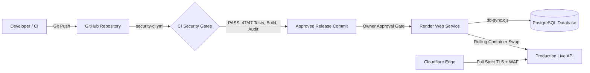

# Phase 3 Production Deployment & Rollback Runbook
**Project:** LightningDeals / Lightning API Gateway  
**Repository:** `HopUppper/lightningdeals-api`  
**Hosting Environment:** Render Web Service  
**Edge / DNS:** Cloudflare  
**Target Branch:** `security/phase3-production-hardening`  
**Date:** October 19, 2026  

---

## 1. Deployment Architecture & Pipeline



---

## 2. Pre-Flight Verification Gates (Mandatory Before Deploy)

Before triggering any deployment to the Render production environment, all of the following gates must be confirmed locally or in CI:

1. **Gate 1: Full Security Regression Test Suite:**
   ```bash
   npm run test:security:all
   ```
   *Pass Criteria:* 47/47 tests passing (Phase 1: 19 tests, Phase 2: 15 tests, Phase 3: 13 tests, 0 failures).
2. **Gate 2: Cryptographic Audit Trail Verification:**
   ```bash
   npm run verify:audit
   ```
   *Pass Criteria:* Audit log SHA-256 chain verified across all stored records with 0 broken links.
3. **Gate 3: TypeScript Type Checking:**
   ```bash
   npx tsc --noEmit
   ```
   *Pass Criteria:* 0 type errors.
4. **Gate 4: Production Build Verification:**
   ```bash
   npm run build
   ```
   *Pass Criteria:* Clean Vite frontend bundle generation and SSG pre-rendering without errors.
5. **Gate 5: Environment Variables Validation:**
   - Confirm in Render dashboard that all mandatory variables are populated with production-strength values:
     - `NODE_ENV=production`
     - `DATABASE_URL` (PgBouncer connection string)
     - `DIRECT_URL` (Direct port 5432 connection string)
     - `JWT_SECRET` (>= 32 characters, random entropy)
     - `DATA_ENCRYPTION_KEY` (>= 32 characters)
     - `SECURITY_EPOCH` (valid Unix timestamp in seconds)
     - `INTEGRATION_API_KEY` (machine-to-machine key)

---

## 3. Deployment Sequencing on Render

### Step 1: Push Approved Phase 3 Commit
```bash
git checkout security/phase3-production-hardening
git push origin security/phase3-production-hardening
```

### Step 2: Render Rolling Deployment
Render automatically executes the configured `buildCommand` and `startCommand`:
1. **Build Phase:**
   ```bash
   npm install && npm run build
   ```
2. **Pre-Deploy Synchronization:**
   ```bash
   node scripts/db-sync.cjs
   ```
   *Safety Note:* Phase 3 enforces safe push; destructive `--accept-data-loss` is disabled by default.
3. **Container Boot & Health Check:**
   - Render boots the new container instance.
   - The container runs `validateEnvironmentOnStartup()`. If any required environment variable is missing, it exits with code 1, preventing bad deploys from taking live traffic.
   - Render polls `/health` (instant 200) and `/ready` (validates database).
   - Once `/ready` responds with 200, Render shifts incoming ingress traffic from the old container to the new container and terminates the old container.

---

## 4. Post-Deployment Smoke Test Suite

Immediately following deployment, run synthetic smoke tests against `https://lightningapi.pro`:

| Test Case | Command / Request | Expected Result |
|:---|:---|:---:|
| **Liveness Check** | `curl -f -s https://lightningapi.pro/health` | HTTP 200 `{"status":"healthy","check":"liveness"}` |
| **Readiness Check** | `curl -f -s https://lightningapi.pro/ready` | HTTP 200 `{"status":"ready","database":"connected"}` |
| **Framework Disclosure** | `curl -I -s https://lightningapi.pro/health \| grep -i x-powered-by` | Empty (No header returned) |
| **Security Headers** | `curl -I -s https://lightningapi.pro/health \| grep -i permissions-policy` | `camera=(), microphone=(), geolocation=()` |
| **CORS Protection** | `curl -H "Origin: https://malicious-site.com" -I -s https://lightningapi.pro/api/health` | No `Access-Control-Allow-Origin` header |
| **Sanitized Status** | `curl -s https://lightningapi.pro/api/public/status` | No `latencyMs` or raw error strings exposed |
| **Gateway Auth** | `curl -H "Authorization: Bearer invalid_token" -s https://lightningapi.pro/api/v1/chat/completions` | HTTP 401 Unauthorized with standard error envelope |

---

## 5. Rollback & Forward-Fix Strategy

### Safe Rollback Principles
> [!WARNING]
> Never blindly roll back to a pre-incident commit that reintroduces known vulnerabilities (such as Phase 1 or Phase 2 bypasses).

1. **Immediate Health Failure during Deploy:**
   - If the new container fails startup validation or fails `/ready`, Render automatically keeps the existing container running. Ingress traffic is not affected.
2. **Post-Deploy Regression Detected:**
   - If a regression is discovered after deployment:
     - **Option A (Forward-Fix - Preferred for Security Patches):** Identify the defect, push a targeted one-line fix to the Phase 3 branch, and trigger a fast deploy.
     - **Option B (Rollback to Verified Baseline):** If rollback is required, roll back strictly to the verified Phase 2 commit (`d9092f9`). Never roll back to unhardened legacy commits.

---

## 6. Cloudflare Edge Configuration Checklist

Ensure the following settings are active in the Cloudflare Dashboard for `lightningapi.pro`:
- [x] **SSL/TLS Mode:** Full (Strict) — ensures encrypted communication between Cloudflare and Render.
- [x] **Always Use HTTPS:** Enabled (Enforces 301 redirects for any plain HTTP traffic).
- [x] **Client IP Header:** Ensure `CF-Connecting-IP` is passed to the origin (consumed by `server/rateLimit.ts`).
- [x] **Bypass Caching for API:** Cache Rule configured to bypass cache for `lightningapi.pro/api/*` to prevent caching authenticated responses.
- [x] **Server-Sent Events (SSE) Buffering:** Disable response buffering for `/api/v1/chat/completions` to allow streaming token output to clients.
- [x] **WAF Managed Rules:** Enable Cloudflare Managed Ruleset to drop common OWASP Top 10 web exploit attempts at the perimeter.

---
**Runbook Status:** Active & Standardized for Phase 3 Deployment.
