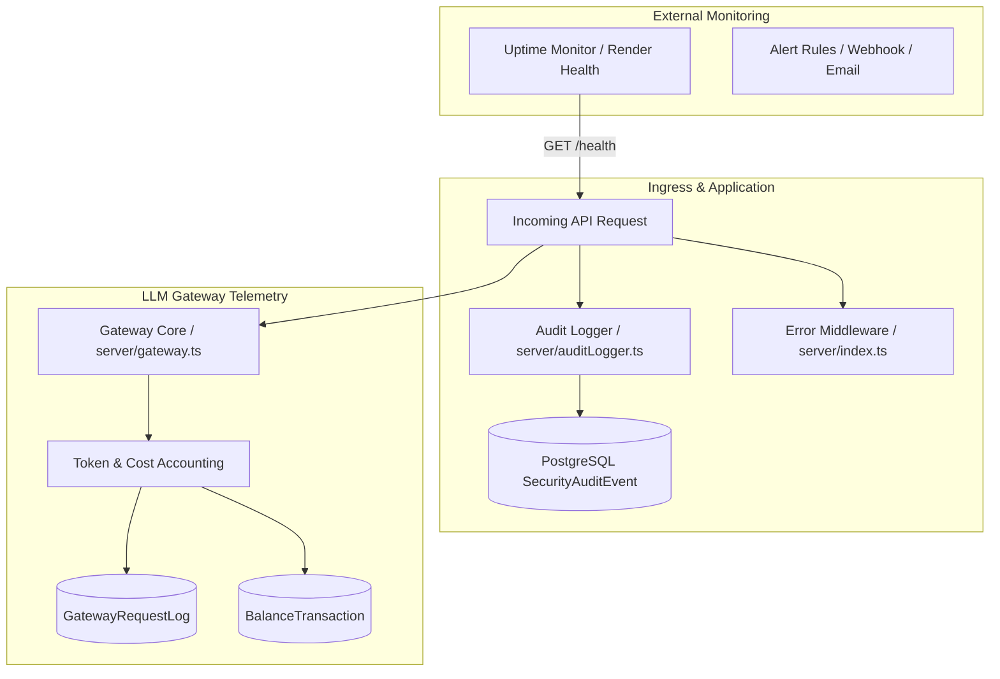
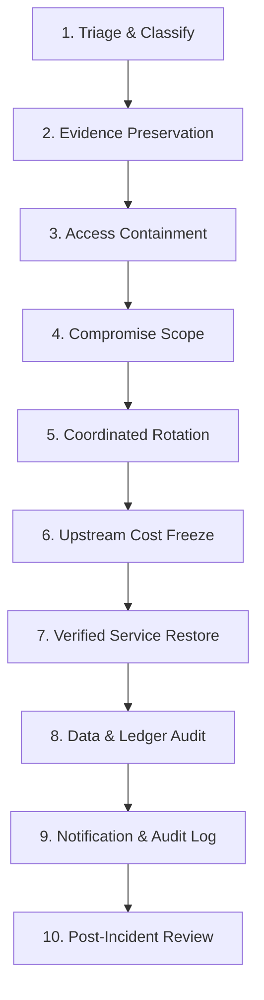

# Phase 3 Monitoring, Alerting & Incident Response Runbook
**Project:** LightningDeals / Lightning API Gateway  
**Repository:** `HopUppper/lightningdeals-api`  
**Target Branch:** `security/phase3-production-hardening`  
**Classification:** Operational Security & Incident Response  
**Date:** October 19, 2026  

---

## 1. Observability Architecture & Telemetry Signals

The Lightning API gateway handles high-throughput LLM proxy traffic and financial billing ledgers. Observability requires tracking both application health and operational financial anomalies.



### Telemetry Signals & Metrics Inventory

| Signal Name | Source | Alert Threshold / Trigger | Severity | Action |
|:---|:---|:---|:---:|:---|
| **Process Availability** | `/health` | 2 consecutive non-200 responses | P0 | Check Render container logs, restart if hung |
| **Database Connectivity** | `/ready` | HTTP 503 response | P0 | Check Supabase pooler / database status |
| **Authentication Spike** | `SecurityAuditEvent (AUTH_FAILED)` | > 20 failures/min from single IP or user | P1 | IP rate limit / Cloudflare firewall block |
| **Decryption Failure** | `[SECURITY ERROR] Vault decryption failed` | Any occurrence | P0 | Immediate key mismatch alert; halt deployments |
| **Provider Upstream Errors** | Gateway upstream error responses | > 10% error rate over 5 mins | P2 | Fail over to backup AI provider / notify users |
| **Abnormal Spending Spike** | `GatewayRequestLog.costUsd` | Hourly spend exceeds 300% historical mean | P1 | Provider balance freeze, rate limit tenant |
| **Customer Quota Exhaustion**| `server/gateway.ts` | Repeated 402/429 balance exhaustion | P3 | Customer notification / balance top-up prompt |

---

## 2. Redaction & Log Privacy Standards

All loggers (`server/auditLogger.ts`, standard console logs, and Express error handlers) enforce strict redaction rules:
1. **Never Log Key Material:** API keys (`ld_live_...`), passwords, authorization bearer tokens, and JWT strings must never be emitted.
2. **Decryption Error Redaction:** Decryption failures emit a static diagnostic string (`[SECURITY ERROR] Vault decryption failed`) with zero ciphertext or key bytes.
3. **Audit Event Sanitization:** The `SecurityAuditEvent` table stores metadata hashes and actor IDs, never raw passwords or full credit card numbers.

---

## 3. Ten-Step Incident Response Playbook



### Step 1: Confirm and Classify the Incident
- **Sev-0 (Critical):** Active data breach, root admin compromise, leaked provider master keys, or arbitrary code execution.
- **Sev-1 (High):** Authentication bypass, abnormal financial spending spike, single user account takeover, or complete service outage.
- **Sev-2 (Medium):** Degraded provider latency, rate-limiting bypass, or isolated non-sensitive data error.

### Step 2: Preserve Logs and Evidence
- Capture container logs from Render before restarting instances.
- Execute audit chain verification to create an immutable snapshot:
  ```bash
  npx tsx scripts/verify-audit-chain.ts
  ```
- Export the latest PostgreSQL audit logs:
  ```bash
  psql "$DATABASE_URL" -c "COPY (SELECT * FROM \"SecurityAuditEvent\" ORDER BY \"timestamp\" DESC LIMIT 500) TO STDOUT WITH CSV HEADER;" > incident_audit_records.csv
  ```

### Step 3: Restrict Affected Access Safely
- If an API key is leaking or compromised:
  ```sql
  UPDATE "ApiKey" SET "status" = 'REVOKED' WHERE "id" = '<KEY_ID>';
  ```
- If a user account or admin account is compromised:
  ```sql
  UPDATE "User" SET "passwordChangedAt" = NOW() WHERE "id" = '<USER_ID>';
  ```
- If edge blocking is needed, block the attacking IP or subnet immediately in Cloudflare WAF.

### Step 4: Identify Potentially Compromised Credentials
- Review Git commit history and environment logs.
- Cross-reference access logs to determine if `JWT_SECRET`, `DATA_ENCRYPTION_KEY`, or upstream provider keys were exposed.

### Step 5: Coordinate Credential Rotation
- Follow `docs/security/PHASE3_SECRETS_AND_ROTATION_RUNBOOK.md`.
- Advance `SECURITY_EPOCH` to immediately kill all outstanding session tokens.
- Rotate `DATA_ENCRYPTION_KEY` using dual-key migration if vault keys were compromised.

### Step 6: Contain Unexpected Provider Spending
- If an upstream AI provider key (OpenAI, Anthropic) was compromised or abused:
  1. Revoke the key in the provider's developer console (e.g. OpenAI Platform).
  2. Generate a new provider key with hard spending limits enabled.
  3. Update the provider record in Lightning API's database using the secure admin endpoint or encrypted migration.

### Step 7: Restore Service Without Reintroducing Vulnerable Code
- Deploy only verified commits from `security/phase3-production-hardening` or `security/phase2-hardening`.
- Verify the deployment passes all pre-flight gates and smoke tests.

### Step 8: Validate Customer Data and Accounting Records
- Reconcile customer balances:
  ```sql
  SELECT u.id, u.email, u."balanceUsd", SUM(b.amount) as ledger_total
  FROM "User" u
  LEFT JOIN "BalanceTransaction" b ON u.id = b."userId"
  GROUP BY u.id, u.email, u."balanceUsd"
  HAVING ABS(u."balanceUsd" - COALESCE(SUM(b.amount), 0)) > 0.01;
  ```
- Confirm no unauthorized balance adjustments were inserted.

### Step 9: Record Actions and Notify Affected Parties
- Insert a permanent event into `SecurityAuditEvent` recording the incident details and remediation actions taken.
- If customer credentials or data were exposed, draft an advisory notification adhering to regulatory and compliance standards.

### Step 10: Conduct a Post-Incident Review (Blameless Post-Mortem)
- Identify root causes, contributing factors, timeline, and mitigation effectiveness.
- Author an incident post-mortem and add new automated regression tests to prevent regression.

---

## 4. Operational Monitoring Status

- **Application Structured Logging & Redaction:** **`PASS`** (Verified in codebase).
- **Cryptographic Audit Trail Integrity:** **`PASS`** (Verified by `scripts/verify-audit-chain.ts`).
- **Liveness & Readiness Health Probes:** **`PASS`** (Verified by tests `P3-HEALTH-01`, `P3-HEALTH-02`).
- **Live Alerting Webhooks (Render / PagerDuty / Slack):** **`BLOCKED`** (Requires owner to configure alert webhooks in Render / Cloudflare dashboards).

---
**Runbook Status:** Active & Standardized for Incident Response Operations.
