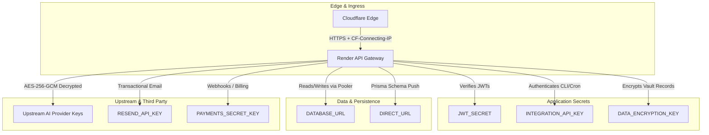

# Phase 3 Secrets Management & Credential Lifecycle Runbook
**Project:** LightningDeals / Lightning API Gateway  
**Repository:** `HopUppper/lightningdeals-api`  
**Target Branch:** `security/phase3-production-hardening`  
**Classification:** Operational Security Runbook (NO SECRETS EMBEDDED)  
**Date:** October 19, 2026  

---

## 1. Secrets Architecture Overview

Lightning API handles multiple categories of sensitive cryptographic keys and credentials. Each category has distinct lifecycle properties, blast radiuses, and rotation procedures.



> [!CAUTION]
> Under no circumstances should real secret values, passwords, private keys, or API tokens be committed to Git, posted in issue trackers, printed in CI logs, or exposed in documentation. Use only variable names and status indicators.

---

## 2. Production Secret Inventory

| Variable Name | Category | Primary Consumer | Purpose | Rotation Impact | Transition Support |
|:---|:---|:---|:---|:---|:---:|
| `JWT_SECRET` | Authentication | `server/user.ts`, `server/auth.ts` | Signs & verifies user session JWTs | Invalidates active user sessions | Dual-secret or security epoch |
| `SECURITY_EPOCH` | Authentication | `server/user.ts` | Unix timestamp; rejects older tokens | Forces re-login for tokens issued `< epoch` | Epoch timestamp cutoff |
| `DATABASE_URL` | Persistence | `server/db.ts` (Prisma pooler) | Production pooled database connection | Temporary API connection disruption | Zero-downtime pooler swap |
| `DIRECT_URL` | Persistence | `prisma/schema.prisma` | Direct port 5432 migration connection | Disables schema push/migrations | Independent from pooler |
| `DATA_ENCRYPTION_KEY` | Cryptography | `server/db.ts` | Master AES-256-GCM vault encryption | Decryption failure if rotated unsafely | **Dual-key transition (`OLD_DATA_ENCRYPTION_KEY`)** |
| `INTEGRATION_API_KEY` | Machine Auth | `server/integrationAuth.ts` | Authorizes automated CLI/cron scripts | CLI scripts fail until updated | Key alias / dual-auth |
| `RESEND_API_KEY` | Third-Party | `server/email.ts` | Transactional email delivery | Email notifications fail | Independent |
| `PAYMENTS_SECRET_KEY` | Third-Party | `server/payments/` | Webhook verification & payment processing | Payment webhooks fail | Webhook secret rotation |
| Upstream AI Provider Keys | Upstream | Database (`VendorProvider`) | Decrypted in-memory to call AI models | Provider calls fail if invalid | In-database re-encryption |

---

## 3. Secret Rotation Procedures

### Procedure A: Vault Data Encryption Key (`DATA_ENCRYPTION_KEY`)
- **Blast Radius:** Critical (Affects all stored upstream provider keys, API key hashes, and inventory items).
- **Prerequisites:** Must retain the old key during the rotation window.
- **Fail-Closed Rule:** If decryption fails, `decryptText` returns `''` and does NOT leak ciphertext.
- **Zero-Downtime Migration Steps:**
  1. Generate a new high-entropy 32-byte secret (represented as 64 hex characters or strong 32+ character passphrase).
  2. Set the current key as `OLD_DATA_ENCRYPTION_KEY` in Render.
  3. Set the new key as `DATA_ENCRYPTION_KEY` in Render.
  4. Trigger a rolling restart. At this stage, `server/db.ts` will decrypt using the primary key, fall back to `OLD_DATA_ENCRYPTION_KEY` if needed, and write all new records using the new key.
  5. Run the atomic migration script in dry-run mode:
     ```bash
     npx tsx scripts/rotate-vault-encryption.ts --dry-run
     ```
  6. Execute the live migration across `VendorProvider`, `ApiKey`, and `InventoryItem`:
     ```bash
     npx tsx scripts/rotate-vault-encryption.ts
     ```
  7. Verify all records have been re-encrypted with the new key version (`gcm:v1:...`).
  8. Once confirmed, remove `OLD_DATA_ENCRYPTION_KEY` from the Render environment.

---

### Procedure B: User Session JWT Secret (`JWT_SECRET`)
- **Blast Radius:** High (Invalidates active sessions across web clients).
- **Graceful Rotation Steps:**
  1. If rotating without forcing mass logout:
     - The application supports verifying with the primary `JWT_SECRET` and falling back to `OLD_JWT_SECRET` (if configured), while issuing new tokens exclusively with `JWT_SECRET`.
  2. If responding to a suspected compromise (Emergency Invalidation):
     - Generate a new 64-character random string:
       ```bash
       node -e "console.log(require('crypto').randomBytes(32).toString('hex'))"
       ```
     - Update `JWT_SECRET` in the Render Dashboard.
     - Advance `SECURITY_EPOCH` to the current Unix timestamp (`Math.floor(Date.now() / 1000)`).
     - Redeploy the application. All previously issued tokens are immediately rejected.

---

### Procedure C: Database Credentials (`DATABASE_URL` & `DIRECT_URL`)
- **Blast Radius:** Critical (Brief API downtime if connections are terminated during rotation).
- **Safe Rotation Sequencing:**
  1. In the database provider console (Supabase / Managed PostgreSQL), create a new user password or secondary connection string.
  2. Update `DIRECT_URL` first in Render environment variables.
  3. Update `DATABASE_URL` (pooled connection string).
  4. Render initiates a zero-downtime rolling deployment. The new container spins up, checks `/health` and `/ready` against the new database URL, and transitions traffic once verified.
  5. In Supabase, terminate old connection pool sessions.

---

### Procedure D: Integration API Key (`INTEGRATION_API_KEY`)
- **Blast Radius:** Medium (Affects automated backend scripts, health pingers, and CLI sync jobs).
- **Rotation Sequence:**
  1. Generate a new high-entropy integration token (`ld_int_...`).
  2. In Render, update `INTEGRATION_API_KEY`.
  3. Update downstream CLI clients or automation runners with the new key.
  4. Verify with:
     ```bash
     curl -H "x-integration-key: <NEW_KEY>" https://lightningapi.pro/api/health
     ```

---

## 4. Git & Repository Hygiene Controls

1. **Pre-Commit Verification:**
   - `.gitignore` explicitly blocks `.env`, `.env.local`, `.env.production`, and credential dumps.
   - Example template `.env.example` contains only placeholder values (`CHANGE_ME_IN_PRODUCTION`).
2. **CI Secret Scanning:**
   - GitHub Actions workflow `.github/workflows/security-ci.yml` runs automatic checks on every push to detect hardcoded high-entropy tokens and unauthorized `.env` files.
3. **Log Scrubbing Policy:**
   - Application logger (`server/auditLogger.ts` and Express middleware) strips `authorization`, `x-api-key`, `cookie`, and password fields before logging.
   - Decryption failures log a sanitized string without plaintext or ciphertext:
     ```typescript
     console.error('[SECURITY ERROR] Vault decryption failed: invalid ciphertext or key mismatch');
     ```

---
**Runbook Status:** Active & Standardized for Phase 3 Operations.
