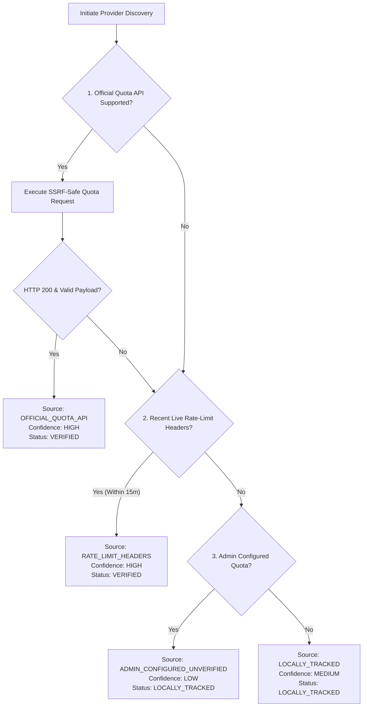

# Provider Capability & Token Limit Discovery Architecture

## 1. Overview

LightningDeals AI Gateway integrates with multiple upstream AI providers (such as Anthropic, OpenAI-compatible gateways, and custom HTTP supplier proxies). In production, managing upstream quota requires reliable, evidence-based provider capability discovery rather than arbitrary constants or guessed endpoint probing.

Historically, the gateway attempted to probe up to 15 guessed endpoint paths (such as `/v1/credits`, `/api/user/self`, `/v1/dashboard/billing/credit_grants`) and applied artificial multipliers (`val < 10000 ? val * 500000 : val`). This caused connection failures, false-positive errors, and fabricated capacity figures.

This document describes the modern, SSRF-safe, adapter-based provider discovery architecture that replaces all speculative probing with verified telemetry.

---

## 2. Discovery Priority Hierarchy

When discovering upstream capacity and quotas, the gateway strictly adheres to the following priority hierarchy:

### Hierarchy Breakdown:
1. **Official Provider Quota API**: Documented provider quota endpoints, executed only when officially supported and specified in the provider adapter.
2. **Documented Rate-Limit Headers**: Extracting standard headers (`anthropic-ratelimit-tokens-limit`, `anthropic-ratelimit-tokens-remaining`, `anthropic-ratelimit-tokens-reset` or `x-ratelimit-*`) returned on authenticated completions within the last 15 minutes.
3. **Admin Configured Quota with Local Accounting**: When an administrator configures an expected quota (e.g. 20,000,000 tokens / 5h), usage is tracked against verified local request logs, labeled explicitly as `ADMIN_CONFIGURED_UNVERIFIED` with `LOW` confidence.
4. **Pure Local Accounting**: When no quota is configured or returned by headers, verified consumption from `ApiRequest` records is reported without fabricating an imaginary limit.

---

## 3. Protocol-Specific Provider Realities

### 3.1 Anthropic Protocol (`AnthropicAdapter`)
- **Official Credits API**: Anthropic does **not** provide a public `/v1/credits` or `/v1/usage` balance endpoint. Sending requests to `/v1/credits` results in HTTP 404/401 errors.
- **Rate-Limit Headers**: Anthropic returns authoritative rate-limit metadata on live `/v1/messages` responses:
  - `anthropic-ratelimit-tokens-limit`: Current minute/window token ceiling.
  - `anthropic-ratelimit-tokens-remaining`: Remaining tokens available.
  - `anthropic-ratelimit-tokens-reset`: RFC 3339 timestamp of the next window reset.
- **Idle Discovery Strategy**: When no live traffic is present, the adapter computes consumed tokens from verified `ApiRequest` records. If an admin configured a rolling window allowance, it calculates remaining headroom as `limit - consumedInWindow` and labels it `ADMIN_CONFIGURED_UNVERIFIED`. It **never** generates speculative HTTP requests to unapproved URLs.

### 3.2 OpenAI-Compatible Protocol (`OpenAICompatibleAdapter`)
- **Capability Check**: Connects to the standard `/v1/models` endpoint using strict SSRF guards to verify credential validity and fetch available models.
- **Rate-Limit Headers**:
  - `x-ratelimit-limit-tokens`
  - `x-ratelimit-remaining-tokens`
  - `x-ratelimit-reset-tokens`: Supports standard duration strings (e.g. `6m0s`, `15ms`, `2s`) as well as ISO dates.
- **Reasoning Tokens**: Inspects `completion_tokens_details.reasoning_tokens` and `prompt_tokens_details.cached_tokens`.

### 3.3 Custom HTTP Protocol (`CustomHttpAdapter`)
- Designed for secure supplier proxies (e.g., Opus Max, ScaleMax).
- Enforces strict SSRF and DNS-rebinding verification on `baseUrl`.
- Extracts rate headers if returned; otherwise aggregates usage from verified database records.

---

## 4. SSRF Defense & Discovery Security

All provider discovery network calls are routed through `safeDiscoveryFetch` in `server/providers/SafeDiscoveryClient.ts`, enforcing the following mitigations:

1. **Protocol Restriction**: Only `http:` and `https:` schemes are accepted.
2. **Port Restriction**: Restricts connections to standard web ports (80 and 443).
3. **Loopback & Private Subnet Blocking**:
   - Loopback: `127.0.0.0/8`, `localhost`, `::1`.
   - RFC 1918 Private Ranges: `10.0.0.0/8`, `172.16.0.0/12`, `192.168.0.0/16`.
   - Cloud Metadata / Link-Local: `169.254.0.0/16`, `metadata.google.internal`.
   - CGNAT: `100.64.0.0/10`.
4. **DNS Rebinding Mitigation (TOCTOU)**: Custom DNS lookup function (`safeLookup`) validates the resolved IP address on **every single socket connection attempt**, preventing attackers from exploiting DNS TTL manipulation to bypass SSRF filters.
5. **Bounded Execution**: Hard timeouts (5,000ms max) and response payload limits (64KB max) protect against hanging requests and memory exhaustion.

---

## 5. Confidence & Status Matrix

| Discovery Source | Status | Confidence | When Used |
| :--- | :--- | :--- | :--- |
| `OFFICIAL_QUOTA_API` | `VERIFIED` | `HIGH` | Provider returned quota via official documented quota API. |
| `RATE_LIMIT_HEADERS` | `VERIFIED` | `HIGH` | Extracted from verified response headers within last 15 minutes. |
| `LOCALLY_TRACKED` | `LOCALLY_TRACKED` | `MEDIUM` | Calculated from database `ApiRequest` records; no limit configured. |
| `ADMIN_CONFIGURED_UNVERIFIED` | `LOCALLY_TRACKED` | `LOW` | Tracked locally against an admin-configured capacity value. |
| `NOT_DISCOVERED` | `UNAVAILABLE` | `UNKNOWN` | Provider disabled, master key missing, or connection failed. |
