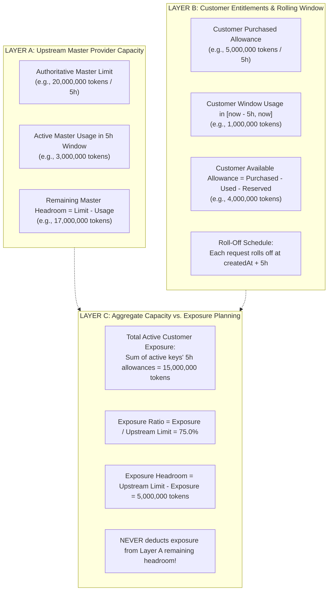
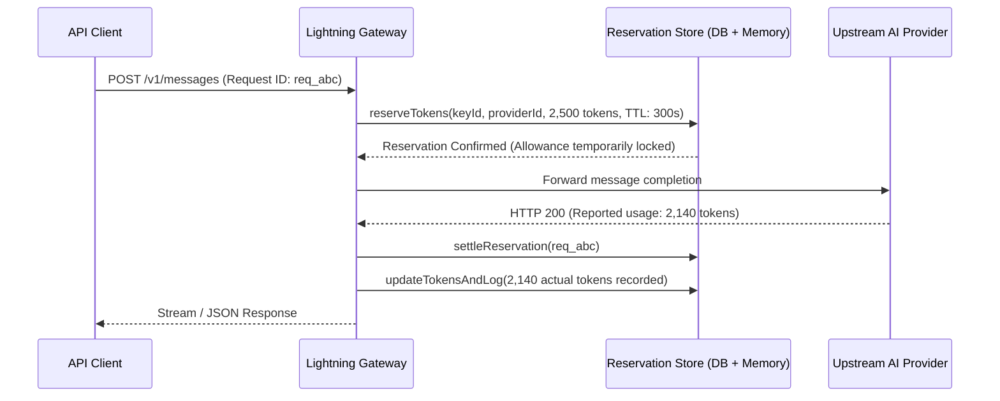

# Three-Layer Token Accounting Model & Rolling-Window Architecture

## 1. Executive Summary

In multi-tenant AI gateway infrastructure, conflating customer entitlement allowances with upstream provider consumption is a critical vulnerability. If an aggregate customer allowance of 15,000,000 tokens is subtracted from an upstream provider limit of 20,000,000 tokens, the gateway would incorrectly display only 5,000,000 tokens remaining, despite only 3,000,000 tokens having actually been consumed.

LightningDeals AI Gateway enforces a strict **Three-Layer Accounting Model** that mathematically and architecturally decouples upstream vendor capacity, customer entitlements, and aggregate exposure.

---

## 2. The Three Accounting Layers



### Layer A: Upstream Master Provider Capacity
- **Authoritative Master Limit ($L_{upstream}$)**: Discovered via live rate-limit headers (`anthropic-ratelimit-tokens-limit` or `x-ratelimit-limit-tokens`), official quota API, or administrator configuration.
- **Upstream Window Usage ($U_{upstream}$)**: Sum of all billable tokens (`input_tokens + output_tokens + cached_tokens`) for requests routed to this provider strictly within the current rolling window ($[t_{now} - 5h, t_{now}]$).
- **Known Remaining Master Headroom ($R_{upstream}$)**:
  $$\ R_{upstream} = \max(0, L_{upstream} - U_{upstream} - Res_{master}) \$$
- **Telemetry Labels**: Every figure displayed carries its `discoverySource` (`RATE_LIMIT_HEADERS`, `OFFICIAL_QUOTA_API`, `LOCALLY_TRACKED`, `ADMIN_CONFIGURED_UNVERIFIED`) and `discoveryConfidence` (`HIGH`, `MEDIUM`, `LOW`, `UNKNOWN`).

### Layer B: Customer Entitlements & Independent Rolling Windows
- Each customer API key operates on its own independent rolling 5-hour window.
- **Window Query**:
  ```sql
  SELECT SUM("totalTokens") 
  FROM "ApiRequest" 
  WHERE "apiKeyId" = :apiKeyId 
    AND "createdAt" >= NOW() - INTERVAL '5 hours';
  ```
- **Remaining Window Allowance**:
  $$\ R_{customer} = \max(0, A_{customer} - U_{window} - Res_{customer}) \$$
- **Permanent Depletion Prevention**: For rolling-window keys, `tokensRemaining` in `ApiKey` is not permanently decremented on each request. As requests age beyond 5 hours, tokens naturally roll off, continually restoring customer allowance without manual intervention.

### Layer C: Aggregate Capacity vs. Customer Allowance Exposure
- **Active 5H Entitlement Exposure ($E_{5h}$)**: Sum of purchased 5-hour allowances across all active customer API keys:
  $$\ E_{5h} = \sum_{k \in Keys_{active}} A_k \$$
- **Exposure Headroom ($H_{exposure}$)**:
  $$\ H_{exposure} = L_{upstream} - E_{5h} \$$
- **Exposure Ratio**:
  $$\ \text{Ratio} = \frac{E_{5h}}{L_{upstream}} \times 100\% \$$
- **Rule of Separation**: Exposure represents **maximum potential concurrent demand**, used strictly for capacity planning and oversubscription monitoring. It is **never** deducted from upstream available tokens.

---

## 3. The 20M Upstream / 15M Customer Allocation Business Scenario

Consider the primary operational scenario required by LightningDeals Gateway:

| Metric | Symbol | Value | Interpretation |
| :--- | :--- | :--- | :--- |
| **Upstream Master Limit** | $L_{upstream}$ | **20,000,000 tokens** | Verified vendor 5-hour rolling capacity limit. |
| **Active Customer Keys** | $N$ | **3 keys** (5M allowance each) | Three active Claude Max 5x customers. |
| **Active 5H Allowance Exposure** | $E_{5h}$ | **15,000,000 tokens** | Total concurrent potential demand. |
| **Actual Consumed Tokens (in 5h)** | $U_{upstream}$ | **3,000,000 tokens** | Actual requests executed in window. |
| **Remaining Upstream Capacity** | $R_{upstream}$ | **17,000,000 tokens** | **$20M - 3M = 17,000,000$ tokens** (NOT 5M!). |
| **Exposure Headroom** | $H_{exposure}$ | **5,000,000 tokens** | Capacity to issue 1 additional 5M customer key safely. |
| **Exposure Ratio** | $\%$ | **75.0%** | Gateway capacity is 75% committed. |

---

## 4. Concurrent Token Reservations & Settlement Lifecycle

To prevent race conditions during concurrent high-throughput completions:



- **Reservation TTL**: If upstream fails to respond or process crashes, reservations expire automatically after 300 seconds, releasing the lock without manual intervention.
- **Immediate Error Release**: If client aborts or upstream returns 5xx, `releaseReservation` immediately restores headroom.

---

## 5. Request Idempotency & Deduplication

Network retries (e.g. from Claude Code CLI, Cursor, or SDKs) include an `idempotency-key` header.
- When an `idempotencyKey` is present, the gateway checks if a request with this key was already settled.
- Duplicate requests return the original result or exit early, preventing double-charging of customer allowance or upstream ledger balance.
